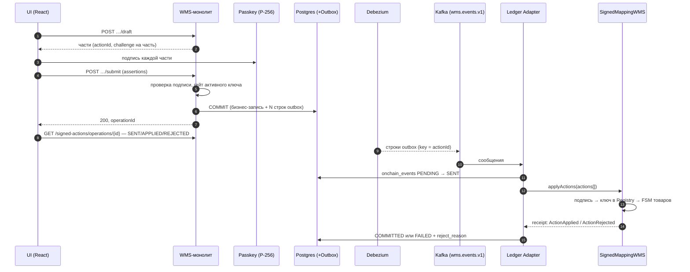

# Архитектура системы

**Версия:** 1.0 (подписанные действия)
**Цель документа:** объяснить «что, зачем и как» — без глубоких знаний блокчейна, с фокусом на проверке логики WMS и ончейн-аудита. Первоисточник архитектуры — [ADR-0001 «Подписанные складские действия»](../adr/0001-signed-actions.md).

> [!SUMMARY] Если в двух словах
> Мы строим WMS-монолит на Go и Postgres, а блокчейн используем как «ленту кассовых чеков» — неизменяемую, независимую от БД запись ключевых этапов (Приёмка → Раскладка → Сборка → Отгрузка).
> Единица записи — **подписанное действие**: оператор подтверждает физическую операцию своим passkey (WebAuthn, P-256), подпись проверяется контрактом через precompile secp256r1 (`0x100`). В цепи остаются статус каждого товара, `keyId` подписанта, организация и хеш деталей действия; полные данные остаются off-chain.

---

## Контекст и цели

- **Что строим:** WMS, который фиксирует 4 ключевых этапа жизненного цикла товара: **Приёмка на столе**, **Раскладка**, **Сборка (подбор)**, **Отгрузка**.
- **Зачем блокчейн:** получить **неизменяемую аудит‑полосу** этих этапов, независимую от нашей БД и админских прав.
- **Почему не всё на блокчейне:** это дорого и медленно для «тяжёлых» данных; нам нужны скорость и SQL для операций и отчётов. Поэтому — минимум on‑chain, максимум off‑chain.
- **Что именно проверяем:** что подписанное действие доходит от браузера оператора до цепи без потерь и дубликатов, что подпись нельзя подделать и что расхождение БД ↔ цепь ловит сверка (аудит).

## Глоссарий простыми словами

- **Подписанное действие** — запись об одном подтверждении оператора: «закрыл грузоместо», «разложил корзину», «выгрузил корзину сборки в буфер», «отгрузил рейс». У действия есть `actionId`, тип, список товаров, хеш деталей и подпись passkey. Ключевые действия (регистрация/отзыв ключа) подписывает админ организации.
- **Конверт (envelope)** — JSON с полями действия и WebAuthn-подписью; он хранится в `outbox_events.payload` и едет в цепь без изменений.
- **Kafka** — «автобус событий» между WMS и Ledger Adapter. Один топик `wms.events.v1`, одна партиция: порядок действий в цепи равен порядку коммитов в БД.
- **Debezium** — «слушатель изменений в БД»: читает WAL и публикует outbox-строки в Kafka.
- **Outbox (аутбокс)** — таблица, куда WMS кладёт событие **в одной транзакции** с бизнес-записью.
- **Blockchain / Avalanche Subnet‑EVM** — отдельная permissioned-сеть, используемая как неизменяемый журнал «кто‑что‑когда сделал».
- **Идемпотентность** — «не навреди при повторе»: повторное действие не создаёт дубликатов.

## Общий обзор архитектуры

### Логическая схема компонентов
```mermaid
flowchart LR
  subgraph UI["Web UI (React)"]
    U1["Оператор / админ"]
    U2["Аудитор"]
  end
  U1 -->|draft / submit + passkey| WMS
  subgraph WMS_APP["WMS-монолит (Go)"]
    WMS["HTTP API / Router"]
    OPS["Операции 4 этапов"]
    SA["signedaction / signedops<br/>черновики, проверка подписи"]
    KEYS["passkeys: ключи и роли"]
    AUTH["Auth (JWT)"]
  end
  subgraph DB["PostgreSQL"]
    PG[("operational + inventory<br/>outbox_events + onchain_events")]
  end
  subgraph KAFKA["Интеграция"]
    DBZ["Debezium Outbox Router"]
    K["Kafka: wms.events.v1"]
    DLQ["Kafka: wms.dlq.v1"]
  end
  subgraph LAD_APP["Ledger Adapter (Go)"]
    LAD["Consumer → сегменты → TX builder"]
  end
  subgraph CHAIN["Avalanche Subnet-EVM (permissioned)"]
    RPC["RPC-узел"]
    SC["ConsortiumRegistry<br/>+ SignedMappingWMS"]
  end
  U2 -->|GET /audit/products/{key}| WMS
  U2 -->|чтение цепи по RPC| RPC
  WMS --> OPS
  OPS <-->|SQL| PG
  SA -->|INSERT outbox| PG
  DBZ -->|CDC| K
  PG --> DBZ
  K --> LAD
  LAD -->|onchain_events| PG
  LAD -->|applyActions / applyKeyActions| RPC --> SC
  K --> DLQ
```

**Ключевая идея:** WMS работает «как обычно» (Go + Postgres). Операция, меняющая состояние товаров, порождает **N подписанных частей-действий** — по строке в `outbox_events` на каждую часть, в одной транзакции с бизнес-записью. Debezium публикует их в один топик Kafka, Ledger Adapter собирает подряд идущие действия и отправляет их в цепь. Подписи проверяет контракт, а не адаптер.

## Как это работает за 5 минут

1. Оператор выполняет шаг в UI (например, **закрытие грузоместа**).
2. Клиент вызывает `POST …/draft`: сервер собирает части действия (товары отсортированы по `itemId`, по ≤ 2000 товаров в части), для каждой части генерирует `actionId`, соль и challenge и возвращает их браузеру.
3. Браузер подписывает каждую часть passkey (`navigator.credentials.get`, P-256) и отправляет все assertion одним `POST …/submit`.
4. Сервер проверяет подписи, в **одной транзакции** применяет бизнес-операцию и пишет строку outbox на каждую часть: `aggregate_type = 'signed_action'`, `event_type = 'wms.action.v1'`, `payload` — конверт действия.
5. Debezium публикует строки в Kafka-топик `wms.events.v1` (key = `actionId`).
6. Ledger Adapter режет окно на сегменты складских и ключевых действий и отправляет `SignedMappingWMS.applyActions(actions[])` / `ConsortiumRegistry.applyKeyActions(actions[])`. Контракт проверяет WebAuthn-подпись, ключ в реестре и FSM-переход каждого товара.
7. Адаптер пишет исход в `onchain_events`: `COMMITTED`, либо `FAILED` с кодом `reject_reason`, если контракт отклонил действие.
8. Гейты WMS читают `warehouse_actions ⋈ onchain_events`: товар с отклонённым действием не идёт на следующий этап.

## Компоненты системы: роли и обязанности

> [!TIP] Принцип разделения
> Два приложения: **WMS-монолит** (вся бизнес-логика, API, ключи, аудит) и **Ledger Adapter** (мост в блокчейн). Общение — через Kafka; обе стороны работают с одной БД Postgres.

### **1) WMS-монолит (Go)**

- **HTTP API / Router** — точка входа для UI, маршрутизация, JWT-аутентификация.
- **Операции 4 этапов** (`receiving`, `putaway`, `assembly`, `shipping`) — бизнес-правила и журналы (`receiving_gate`, `receiving_table`, `putaways`, `assembly_tasks`, `shippings`). Каждый шаг, меняющий товар в цепи, — двухфазный: `draft` (сервер собирает части) → подпись браузером → `submit` (сервер проверяет подписи и коммитит).
- **`signedaction` / `signedops`** — общая математика подписанных действий: challenge, хеш деталей, проверка WebAuthn-assertion, нарезка операции на части ≤ 2000 товаров, строка outbox на каждую часть.
- **`passkeys`** — организации, ключи пользователей и ключевые действия (регистрация/отзыв ключа оператора админом), статус ключа сверяется с реестром в цепи.
- **`ledger`** — гейты цепи: `CheckChainStatus` и `UnconfirmedProducts` читают `warehouse_actions ⋈ onchain_events`.
- **`audit`** — read-only эндпоинт `GET /audit/products/{key}` для аудитора: БД-данные товара, соль и пересчитанные из доменных таблиц детали.
- **Kafka/Outbox:** при коммите каждой подписанной операции — строка outbox на каждую часть-действие.

### **2) Ledger Adapter (Go)**

- **Зачем:** единственная точка записи в блокчейн, один signer на весь консорциум.
- **Функции:**
  - потребитель одного топика `wms.events.v1`: принимает **только** `aggregate_type = 'signed_action'` (чужое — в DLQ);
  - окно сообщений режется на подряд идущие сегменты одного вида: складские действия → `SignedMappingWMS.applyActions`, ключевые → `ConsortiumRegistry.applyKeyActions`; порядок внутри сегмента не меняется;
  - жадная упаковка в лимит calldata (120 000 байт) при сохранении Kafka-порядка: один signer, одна nonce-цепочка;
  - идемпотентность: таблица `onchain_events(event_id, tx_hash, status)`; строки `PENDING → SENT → COMMITTED/FAILED`, при отклонении действия — `reject_reason`;
  - reconcile-loop подтягивает застрявшие `SENT`-строки;
  - read-only API реестра: `GET /registry/keys/{keyId}`.

### **3) Контракты (Solidity)**

- **`ConsortiumRegistry`** — организации и ключи: `registerOrganization` (владелец), `registerAdminKey` (владелец), `revokeKey` (владелец, аварийный отзыв любого ключа), `applyKeyActions` (подписанные админом регистрация/отзыв ключей операторов). Хранит роль ключа (`Admin`/`Operator`), активность и `keyId = keccak256(qx ‖ qy)`.
- **`SignedMappingWMS`** — FSM товара `None → Accepted → PutAway → Picked → Shipped`. `applyActions(actions[])` проверяет подпись каждого действия через Registry (precompile `0x100`) и применяет или отклоняет действие **персонально** — батч никогда не ревертится целиком.
- Подробности — [ADR-0001 §1](../adr/0001-signed-actions.md).

### **4) Роли и полномочия**

| Роль | Кто это | Что может | Источник |
|---|---|---|---|
| **Владелец консорциума** | EOA, задеплоившая `ConsortiumRegistry` (в стенде — ключ ewoq) | Регистрирует организации и ключи админов (`registerOrganization`, `registerAdminKey`), аварийно отзывает любой ключ (`revokeKey`). Складские действия не подписывает. | ADR-0001 §1; `ledger-adapter/cmd/registry-cli` |
| **ADMIN организации** | Пользователь WMS с ролью `ADMIN` и активным ключом админа в реестре | Подписывает ключевые действия: регистрирует PENDING-ключ оператора и отзывает ACTIVE-ключ оператора **своей** организации (`applyKeyActions`). Свой ключ админа отозвать не может; ключ админа в цепи регистрирует только владелец. | ADR-0001 §1; `wms/internal/passkeys/actions.go` |
| **OPERATOR** | Пользователь WMS с ролью `OPERATOR` и активным ключом оператора | Подписывает складские действия: закрытие грузоместа, раскладку, выгрузку корзины в буфер, отгрузку. Ключевые действия подписывать не может. | ADR-0001 §1; `wms/internal/platform/httputil/authz.go` |
| **AUDITOR** | Пользователь WMS с ролью `AUDITOR` (миграция 0020) | Только чтение: эндпоинт аудита `GET /audit/products/{key}` (доступен также админу). Ни один mutating-эндпоинт ему недоступен; сверку с цепью делает сам через RPC. | `wms/migrations/0020_auditor_role.up.sql`; `wms/internal/audit/http.go` |

Гейты ролей в HTTP — `RequireOperator` / `RequireAdmin` / `RequireAdminOrOperator` / `RequireAuditorOrAdmin` (`wms/internal/platform/httputil/authz.go`). Складские шаги в WMS открыты только роли OPERATOR, ключевые действия — только ADMIN. Роль ключа в цепи (`Admin`/`Operator`) проверяет ещё и контракт: на уровне контракта складское действие может подписать любой активный ключ, ключевое — только ключ админа (ADR-0001 §1).

## Kafka: один топик

| Топик | Назначение | Ключ | Партиции |
|---|---|---|---|
| `wms.events.v1` | Все события: строки подписанных действий (и только они после #19) | `actionId` | **1** |
| `wms.dlq.v1` | «Плохие» сообщения (Dead Letter Queue) | оригинальный ключ | 1 |

- Одна партиция — сознательное решение (`deploy/kafka-init.sh`): порядок действий в цепи равен порядку коммитов в БД, на этом держится сериализация отзыва ключа (ADR-0001 §7, §9).
- Роутинг делает Debezium Outbox EventRouter: topic фиксирован (`wms.events.v1`), `aggregate_type` едет заголовком.

## Debezium и паттерн Outbox: без потерь и дубликатов

> [!TIP] Идея в одном абзаце
> WMS не пишет ни в Kafka, ни в цепь напрямую. Он коммитит в Postgres бизнес-запись + строки outbox **одной транзакцией**. Debezium снимает outbox и публикует в Kafka. Отдельный Ledger Adapter отправляет действия в цепь.

- Повторы и сбои: если Kafka/RPC временно недоступны — строки уже в БД и никуда не пропадут; reconcile-loop подтягивает застрявшие `SENT`.
- Если сообщение прочитано дважды — адаптер снимет дубликат по `event_id`, а контракт — по `actionState`.

## Блокчейн-слой: что пишется в цепь

Контракт пишет такие события:

- **`ActionApplied`** — один раз на действие: `actionId`, `keyId`, организация, `detailsHash`, число товаров.
- **`ItemMoved`** — на каждый товар: `itemId` и новый статус; по нему аудитор находит действия товара.
- **`ActionRejected`** — при отклонении действия с причиной (`RejectReason`).

`detailsHash = keccak256(abi.encode(salt, детали))` связывает действие с доменными таблицами WMS: соль и детали хранятся off-chain (`warehouse_actions.salt`, `warehouse_actions.details`), хеш — в цепи. Сверка пересчитывает хеш из доменных таблиц (ADR-0001 §4).

**Права и ограничения (permissioned-сабнет):** allow-list отправителей транзакций и деплоеров включён в genesis (админ — ключ владельца); транзакцию с чужого адреса узел отклоняет ещё в mempool. Подробности — `deploy/subnet/README.md`.

## Поток подписанного действия



## Гейты: WMS не идёт дальше отклонённого действия

- **Отгрузка требует подтверждённой сборки:** товар без `COMMITTED` Pick-действия не отгружается — 409 `PICKING_NOT_CONFIRMED` (`wms/internal/ledger.UnconfirmedProducts`).
- **Отклонённое действие блокирует следующий этап:** перед раскладкой и перед подбором (`POST /assembly/pick`) WMS сверяет предыдущий этап через `ledger.CheckChainStatus` и отвечает 409 `CHAIN_EVENT_REJECTED`, если действие этого этапа в цепи `FAILED`. Застрявшие `PENDING/SENT` гейт не блокирует: их тянет reconciler адаптера.
- Ключ подписанта должен быть **активен в реестре** на момент submit — иначе 409 `SIGNER_KEY_NOT_ACTIVE`; строка ключа блокируется `FOR SHARE` до конца транзакции (сериализация с отзывом, ADR-0001 §7).

## Аудит: что попадает на блокчейн и как это проверять

> [!IMPORTANT] Зачем аудит
> Любой аудитор может убедиться: товар прошёл этапы **в этом порядке**, действия подписаны **теми ключами**, детали не подменены. Проверка не доверяет ни WMS, ни адаптеру: цепь читается напрямую, подпись пересчитывается, хеш деталей пересобирается из доменных таблиц.

Процедура сверки — в [Процедуре аудита](../integration/audit-procedure.md) (CLI `wms/cmd/audit` и страница `/audit` для роли AUDITOR), теория — ADR-0001 §8.

## Данные и БД (высокоуровнево)

Вся система работает с **одной базой Postgres**: WMS-монолит и Ledger Adapter обращаются к одной БД.

- `products`, `orders`, `bins`, `dispatches` — текущее состояние и справочники.
- `receivings` нет: журнал приёмки — `receiving_gate` (КПП, в цепь не пишет) и `receiving_table`; журналы шагов — `putaways`, `assembly_tasks`, `shippings`. Доменные строки ссылаются на действие: `action_id` (putaways, assembly_tasks, shippings; миграции 0017–0019), `operation_id` (receiving_table; миграция 0016) — по ним сверка пересчитывает детали.
- `warehouse_actions` — части подписанных складских операций: `action_id`, `action_type` (1–4), `item_ids uuid[]`, `salt`, `details_hash`, `challenge`, `details`, `submitted_at`.
- `key_actions` — подписанные ключевые действия (типы 5–6).
- `organizations`, `passkey_credentials` — организации, публичные ключи P-256 и их статусы (`PENDING/ACTIVE/REJECTED/REVOKED`).
- `outbox_events` — событие-действие: `event_id = aggregate_id = actionId`, `payload` — конверт.
- `onchain_events` — учёт отправок: статус и `reject_reason` (идемпотентность адаптера).

## Надёжность, масштабирование и наблюдаемость

**Надёжность:**
- **Без двойной записи:** Outbox + Debezium исключают рассинхрон между БД и Kafka.
- **Идемпотентность всюду:** `event_id` уникален в outbox и `onchain_events`; повтор в контракте отсекается `actionState`.
- **DLQ:** невалидные сообщения уходят в `wms.dlq.v1`.
- **Reconcile:** застрявшие `SENT`-строки подтягиваются фоновым reconcile-loop'ом.

**Наблюдаемость:** метрики RPS/p95 WMS API, лаг Debezium/Kafka, доля ошибок адаптера, p95 времени ончейн-подтверждения, задержка RPC; алерты на рост DLQ и лаг.

## Безопасность и корень доверия

- **Сабнет закрытый:** RPC — в приватной сети; allow-list отправителей и деплоеров в genesis.
- **Подписи:** приватный ключ passkey не покидает аутентификатор; сервер хранит только публичный ключ. Подпись действия проверяют: бэкенд WMS (при submit, с origin и `rpIdHash`) и контракт (precompile `0x100`).
- **Ключи адаптера и владельца:** signer-ключ адаптера и ключ владельца консорциума — окружение/KMS, не БД.
- **Корень доверия** — ключ владельца консорциума (деплойера реестра). Это осознанное ограничение: ключ не передаётся, организацию нельзя деактивировать целиком (владелец отзывает её ключи по одному). См. [Управление ключами](../integration/key-management.md) и ADR-0001 «Последствия».

## Ограничения и потолки

- Одна партиция Kafka и один signer ограничивают масштаб; путь роста — партиция/signer на склад (ADR-0001 «Последствия»).
- Действие вмещает ≤ 2000 товаров (лимит WMS), крупная операция режется на части с отдельными подписями (ADR-0001 §10).
- Владелец консорциума — корень доверия без механизма смены; смена потребует двухшаговой передачи.
