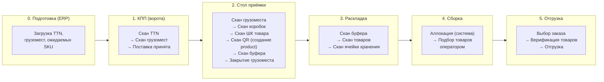
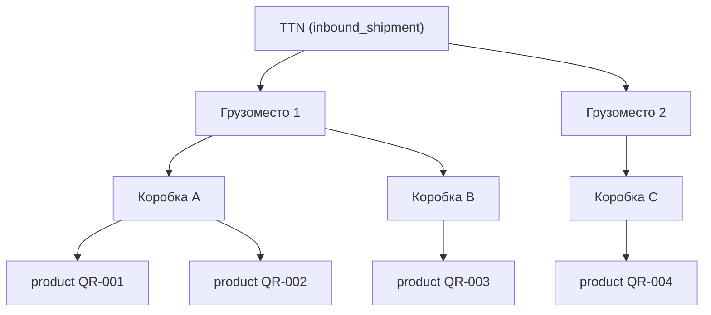
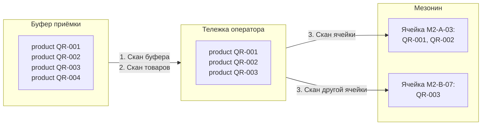
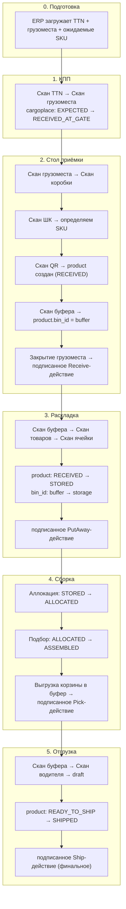

# Сквозной путь товара: от ворот до отгрузки

**Версия:** 1.0
**Дата:** 2026-03-31

Этот документ описывает полный жизненный цикл товара на складе — от момента, когда машина с грузом подъезжает к воротам, до момента, когда собранный заказ уезжает к клиенту. Каждый этап показан глазами оператора: что он делает, что видит на экране, и что происходит «под капотом».

---

## Общая картина



---

## 0. Подготовка (до начала работы на складе)

**Кто:** ERP-система (внешняя)
**Что происходит:** в БД WMS загружаются данные о предстоящей поставке.

**Создаются записи:**
- `inbound_shipments` — одна запись на TTN (статус `CREATED`)
- `cargoplaces` — по одной записи на каждое грузоместо (статус `EXPECTED`)
- `expected_cargoplace_skus` — ожидаемые SKU и количества в каждом грузоместе

**Блокчейн:** ничего не пишем. Данные плановые.

---

## 1. Приёмка на КПП (воротах)

**Кто:** оператор КПП
**Цель:** зафиксировать, какие грузоместа физически приехали на склад

### Что делает оператор

```
1. Сканирует штрихкод ТТН
   → Экран показывает список ожидаемых грузомест (например, 10 шт.)

2. Сканирует каждое грузоместо по очереди
   → Экран: "Грузоместо принято ✓ (3/10)"
   → Если грузоместо не из этой TTN — ошибка

3. Завершает поставку:
   a) Все 10 отсканированы → плашка "Поставка полностью принята"
   b) Отсканировано 7 из 10 → нажимает "Поставка принята"
      → 3 неотсканированных помечаются как NOT_RECEIVED
```

### Что меняется в системе

| Сущность | Было | Стало |
|----------|------|-------|
| `inbound_shipments.status` | CREATED | GATE_IN_PROGRESS → GATE_CLOSED |
| `cargoplaces.status` (отсканированные) | EXPECTED | RECEIVED_AT_GATE |
| `cargoplaces.status` (пропущенные) | EXPECTED | NOT_RECEIVED |
| `receiving_gate` | — | INSERT (лог каждого действия) |

### Блокчейн

**Ничего не пишем.** Товары (`products`) ещё не существуют — мы работаем с грузоместами как транспортными единицами. Блокчейн начинает работать только когда товар получает уникальный QR-код на столе приёмки.

### Подробнее

[receiving-gate-flow.md](../flows/receiving-gate-flow.md)

---

## 2. Приёмка на столе

**Кто:** оператор стола приёмки
**Цель:** вскрыть грузоместо, идентифицировать каждый товар, наклеить уникальный QR, разместить в буфер

### Что делает оператор

```
1. Сканирует грузоместо (только со статусом RECEIVED_AT_GATE)
   → Экран: "Грузоместо открыто. Ожидается X единиц товара"

2. Сканирует штрихкод коробки
   → Экран: "Коробка открыта. Сканируйте товары"

3. Для каждого товара в коробке:
   a) Сканирует ШК товара (штрихкод на упаковке)
      → Система определяет SKU по таблице sku_barcodes
      → Экран: "Найден SKU: Ноутбук Lenovo X1. Наклейте QR."

   b) Наклеивает QR-стикер и сканирует его
      → Система создаёт product (status=RECEIVED)
      → Экран: "Товар зарегистрирован ✓ (5/12)"

4. Нажимает "Завершить работу с коробкой"
   → Коробка закрывается (status=CLOSED)
   → Неотсканированные товары = недостача (нет записей product)

5. Сканирует ячейку буфера приёмки (у каждого стола — свой буфер)
   → Все products грузоместа размещаются в этот буфер (bin_id = buffer_bin_id)

6. Нажимает "Завершить работу с грузоместом"
   → Система сверяет: expected_cargoplace_skus vs реальные products
   → Операция закрывается подписанным Receive-действием: draft → passkey-подпись → submit
   → Экран: "Грузоместо закрыто (принято: 10, ожидалось: 12, недостача: 2)"
```

### Структура вложенности



### Что меняется в системе

| Сущность | Было | Стало |
|----------|------|-------|
| `cargoplaces.status` | RECEIVED_AT_GATE | TABLE_IN_PROGRESS → TABLE_CLOSED |
| `boxes` | — | INSERT (OPEN → CLOSED) |
| `products` | — | **INSERT** (status=RECEIVED, bin_id=NULL) |
| `products.bin_id` | NULL | buffer_bin_id (при скане буфера) |
| `receiving_table` | — | INSERT (лог каждого действия) |
| `warehouse_actions` | — | **INSERT** (строка на каждую часть Receive-операции, ≤2000 товаров) |
| `outbox_events` | — | **INSERT** (1 строка на действие-часть при submit) |

### Блокчейн

Закрытие грузоместа — подписанное действие: `POST /receiving/table/close-cargoplace/draft` строит части с challenge, оператор подписывает каждую passkey, `POST .../submit` проверяет подписи и пишет **одну outbox-строку на действие** (`wms.action.v1`). Debezium публикует их в топик `wms.events.v1`. Ledger Adapter вызывает `SignedMappingWMS.applyActions`. On-chain FSM — на каждый товар: **None → Accepted**.

### Подробнее

[receiving-table-flow.md](../flows/receiving-table-flow.md)

---

## 3. Раскладка (Putaway)

**Кто:** оператор раскладки
**Цель:** перенести товары из буфера приёмки в ячейки хранения на мезонине

### Что делает оператор

```
1. Подходит к буферу, сканирует ячейку буфера
   → Экран: список товаров в буфере (15 шт.)

2. Сканирует QR товаров, которые берёт с собой
   → Экран: "Товар добавлен в корзину раскладки (взято: 3)"
   → Можно взять не все — остальные останутся в буфере

3. Физически кладёт товары на тележку и идёт к мезонину

4. Сканирует ячейку хранения на мезонине
   → Все товары из "корзины" размещаются в эту ячейку
   → Операция закрывается подписанным PutAway-действием: draft → passkey-подпись → submit
   → Экран: "Размещено 3 товара в ячейку M2-A-03 ✓"

5. Может вернуться к буферу и продолжить раскладку оставшихся
```

### Физический процесс



### Что меняется в системе

| Сущность | Было | Стало |
|----------|------|-------|
| `products.status` | RECEIVED | STORED |
| `products.bin_id` | buffer_bin_id | storage_bin_id |
| `putaways` | — | INSERT (product_id, from_bin_id, bin_id, operator_id, action_id) |
| `warehouse_actions` | — | **INSERT** (строка на каждую часть PutAway-операции) |
| `outbox_events` | — | **INSERT** (1 строка на действие-часть при submit) |

### Ограничения в MVP

Система **не проверяет** вместимость ячеек, совместимость SKU, зонирование. Оператор опирается на своё знание склада.

### Блокчейн

Размещение корзины в ячейку — подписанное действие: `POST /putaway/scan-storage-bin/draft` → passkey-подпись → `POST .../submit` → **одна outbox-строка на действие-часть** (`wms.action.v1`, топик `wms.events.v1`). Ledger Adapter вызывает `SignedMappingWMS.applyActions`. On-chain переход (на каждый товар): **Accepted → PutAway**.

### Подробнее

[putaway-flow.md](../flows/putaway-flow.md)

---

## 4. Сборка заказа (Assembly / Picking)

**Кто:** система (аллокация) + оператор сборки (подбор)
**Цель:** назначить конкретные экземпляры товаров на заказ и физически собрать их

### Два этапа

#### 4a. Аллокация (системная, без оператора)

```
Менеджер / система → POST /assembly/allocate {order_id}
→ Система находит нужные products (status=STORED) по SKU заказа
→ Назначает конкретные экземпляры на заказ (FIFO или по ячейке)
→ Создаёт assembly_tasks для каждого product
```

**Outbox events НЕ создаются** — аллокация не меняет on-chain статус.

#### 4b. Подбор (оператор)

```
1. Открывает задачу сборки для заказа
   → Экран: список товаров с указанием ячеек (5 позиций)

2. Идёт к полкам, для каждого товара:
   → Сканирует QR товара
   → Экран: "Товар подобран ✓ (3/5)"
   → Товар в корзине оператора (ASSEMBLED + DONE-задача), без on-chain записи

3. Приходит к буферу магазина, сканирует его
   → Все собранные товары перемещаются в буфер (READY_TO_SHIP)
   → Операция закрывается подписанным Pick-действием: draft → passkey-подпись → submit
```

### Что меняется в системе

| Сущность | Операция | Было | Стало |
|----------|----------|------|-------|
| `products.status` | Аллокация | STORED | ALLOCATED |
| `products.order_id` | Аллокация | NULL | order_id |
| `products.status` | Подбор | ALLOCATED | ASSEMBLED |
| `assembly_tasks.status` | Аллокация | — | INSERT (PENDING) |
| `assembly_tasks.status` | Подбор | PENDING | DONE |
| `products.status` | Выгрузка в буфер | ASSEMBLED | READY_TO_SHIP |
| `orders.status` | — | NEW → ALLOCATED → ASSEMBLED |
| `warehouse_actions` | Выгрузка в буфер | — | **INSERT** (строка на каждую часть Pick-операции) |
| `outbox_events` | Выгрузка в буфер | — | **INSERT** (1 строка на действие-часть, тип 'signed_action') |

### Блокчейн

Подбор с полки (`/assembly/pick`) **не пишет в цепь**. On-chain переход выполняет выгрузка корзины в буфер магазина: `POST /assembly/scan-shipping-buffer/draft` → passkey-подпись → `POST .../submit` → **одна outbox-строка на действие-часть** (`wms.action.v1`, топик `wms.events.v1`) → `SignedMappingWMS.applyActions`. On-chain переход (на каждый товар): **PutAway → Picked**.

### Подробнее

[assembly-flow.md](../flows/assembly-flow.md)

---

## 5. Отгрузка (Shipping)

**Кто:** оператор отгрузки
**Цель:** проверить собранный заказ и отправить его с клиентом/курьером

### Что делает оператор

```
1. Сканирует QR буфера магазина
   → Экран: список готовых к отгрузке товаров

2. Сканирует QR водителя (dispatch_code)
   → Рейс → AT_GATE, проверка destination

3. Нажимает "Отгрузить" (весь буфер или выбранные товары)
   → POST /shipping/ship/draft: буфер режется на части (≤2000 товаров)
   → Оператор подписывает каждую часть passkey
   → POST /shipping/ship/submit: товары → SHIPPED, одна outbox-строка на действие-часть
   → Заказ → SHIPPED
   → Экран: "Заказ отгружен: 5 товаров ✓"
```

### Что меняется в системе

| Сущность | Было | Стало |
|----------|------|-------|
| `products.status` | READY_TO_SHIP | SHIPPED |
| `shippings` | — | INSERT (product_id, dispatch_id, operator_id, action_id) |
| `warehouse_actions` | — | INSERT (строка на каждую часть Ship-операции) |
| `orders.status` | ASSEMBLED / PARTIALLY_SHIPPED | SHIPPED / PARTIALLY_SHIPPED |
| `outbox_events` | — | **INSERT** (1 строка на действие-часть, type='signed_action') |

### Блокчейн

Отгрузка — подписанное действие: `POST /shipping/ship/draft` → passkey-подпись каждой части → `POST .../submit` → **одна outbox-строка на действие-часть** (`wms.action.v1`, топик `wms.events.v1`) → `SignedMappingWMS.applyActions`. On-chain переход (на каждый товар): **Picked → Shipped**. Это **финальный переход** — после Shipped статус на блокчейне не меняется.

### Подробнее

[shipping-flow.md](../flows/shipping-flow.md)

---

## Сводка: путь одного товара



## Параллельный on-chain трек

Каждое подписанное действие проходит один и тот же путь:

```
warehouse_actions (draft) → подпись passkey → outbox_events (PG) → Debezium (CDC) → Kafka wms.events.v1 → Ledger Adapter → SignedMappingWMS (Blockchain)
```

| Этап WMS | Подписанное действие (action_type) | Контракт | On-chain переход |
|----------|------------------------------------|----------|------------------|
| Стол приёмки (close-cargoplace) | Receive (1) | `SignedMappingWMS.applyActions` | None → Accepted |
| Раскладка (scan-storage-bin) | PutAway (2) | `SignedMappingWMS.applyActions` | Accepted → PutAway |
| Сборка (выгрузка корзины, scan-shipping-buffer) | Pick (3) | `SignedMappingWMS.applyActions` | PutAway → Picked |
| Отгрузка (ship) | Ship (4) | `SignedMappingWMS.applyActions` | Picked → Shipped |

**КПП** — единственный этап без on-chain записи (товары ещё не существуют). Подбор с полки (`/assembly/pick`) тоже без on-chain записи — Pick-действие уходит в цепь при выгрузке корзины.
