# Жизненные циклы сущностей

**Версия:** 1.0
**Дата:** 2026-03-31

Все сущности системы, их статусы и переходы — в одном месте. Для каждой сущности указано: какой этап WMS вызывает переход, и есть ли побочные эффекты (outbox events, блокчейн).

---

## products (ключевая сущность)

Единица товара. Создаётся на столе приёмки при сканировании QR. Является объектом отслеживания на блокчейне.

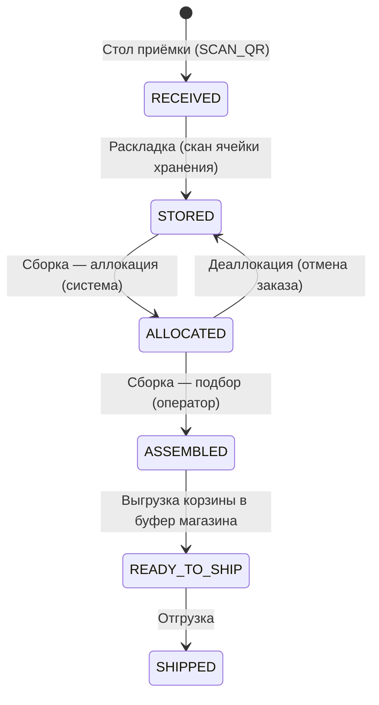

| Переход | Этап WMS | Кто инициирует | Подписанное действие | On-chain |
|---------|----------|---------------|---------------------|----------|
| — → RECEIVED | Стол приёмки | Оператор (SCAN_QR) | Нет (действие создаётся при закрытии грузоместа) | — |
| RECEIVED → STORED | Раскладка | Оператор | PutAway (draft → submit) | Accepted → PutAway |
| STORED → ALLOCATED | Сборка | Система | Нет | — |
| ALLOCATED → STORED | Деаллокация | Система | Нет | — |
| ALLOCATED → ASSEMBLED | Сборка | Оператор (подбор) | Нет (Pick-действие — при выгрузке в буфер) | — |
| ASSEMBLED → READY_TO_SHIP | Сборка | Оператор (скан буфера) | Pick (draft → submit) | PutAway → Picked |
| READY_TO_SHIP → SHIPPED | Отгрузка | Оператор | Ship (draft → submit) | Picked → Shipped |

**Особенность:** подписанное Receive-действие создаётся **не при создании product**, а позже — при закрытии грузоместа (`POST /receiving/table/close-cargoplace/draft` → подпись → `submit`). Подбор с полки (`/assembly/pick`) тоже не пишет в цепь: Pick-действие уходит в цепь при выгрузке корзины в буфер магазина.

### Связанные поля, меняющиеся вместе со статусом

| Статус | bin_id | order_id |
|--------|--------|----------|
| RECEIVED | NULL → buffer_bin_id (при SCAN_BUFFER) | NULL |
| STORED | storage_bin_id | NULL |
| ALLOCATED | storage_bin_id (не меняется) | order_id |
| ASSEMBLED | storage_bin_id | order_id |
| SHIPPED | storage_bin_id | order_id |

---

## inbound_shipments (TTN / поставка)

Транспортная накладная. Верхнеуровневая сущность этапа КПП.

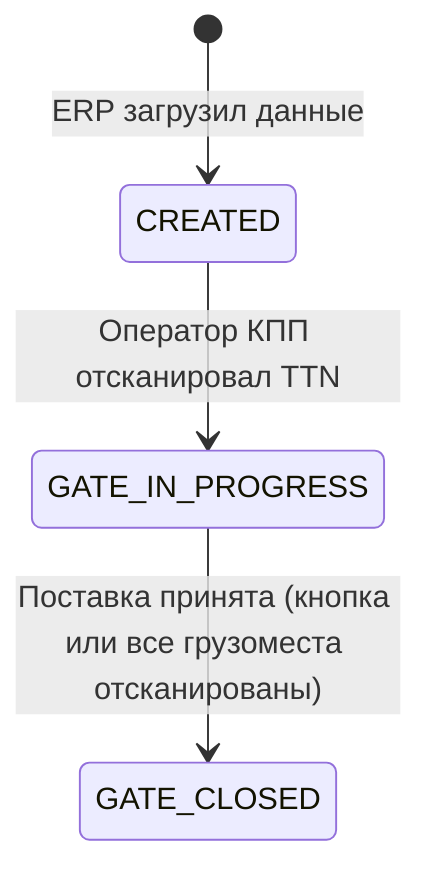

| Переход | Этап WMS | Триггер |
|---------|----------|---------|
| — → CREATED | Подготовка | ERP загружает данные |
| CREATED → GATE_IN_PROGRESS | КПП | POST /receiving/gate/scan-ttn |
| GATE_IN_PROGRESS → GATE_CLOSED | КПП | POST /receiving/gate/accept-shipment или автоматически |

---

## cargoplaces (грузоместо)

Транспортная единица в составе TTN. Содержит коробки с товарами.

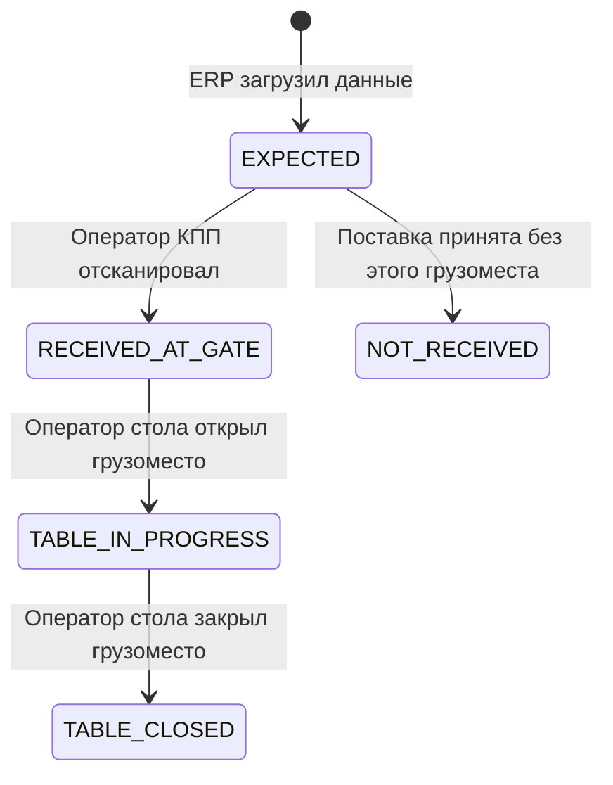

| Переход | Этап WMS | Триггер |
|---------|----------|---------|
| — → EXPECTED | Подготовка | ERP загружает данные |
| EXPECTED → RECEIVED_AT_GATE | КПП | POST /receiving/gate/scan-cargoplace |
| EXPECTED → NOT_RECEIVED | КПП | POST /receiving/gate/accept-shipment (массово) |
| RECEIVED_AT_GATE → TABLE_IN_PROGRESS | Стол приёмки | POST /receiving/table/scan-cargoplace |
| TABLE_IN_PROGRESS → TABLE_CLOSED | Стол приёмки | POST /receiving/table/close-cargoplace/submit (подписанное Receive-действие) |

---

## boxes (коробка)

Упаковочная единица внутри грузоместа. Используется только для структурного учёта на этапе приёмки.

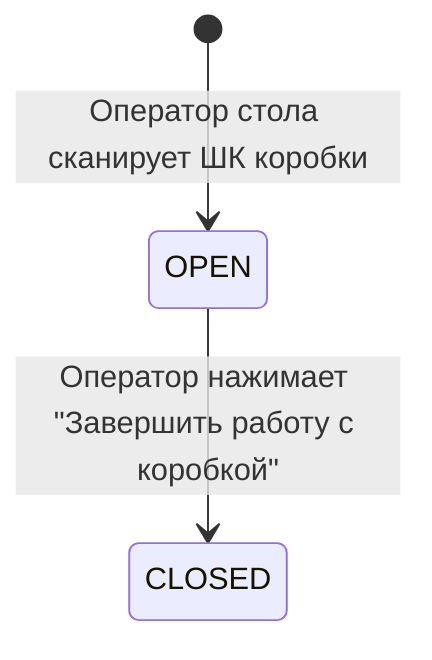

| Переход | Этап WMS | Триггер |
|---------|----------|---------|
| — → OPEN | Стол приёмки | POST /receiving/table/scan-box |
| OPEN → CLOSED | Стол приёмки | POST /receiving/table/close-box |

---

## orders (заказ клиента)

Заказ, содержащий несколько позиций (SKU × количество). Товары назначаются на заказ при аллокации.

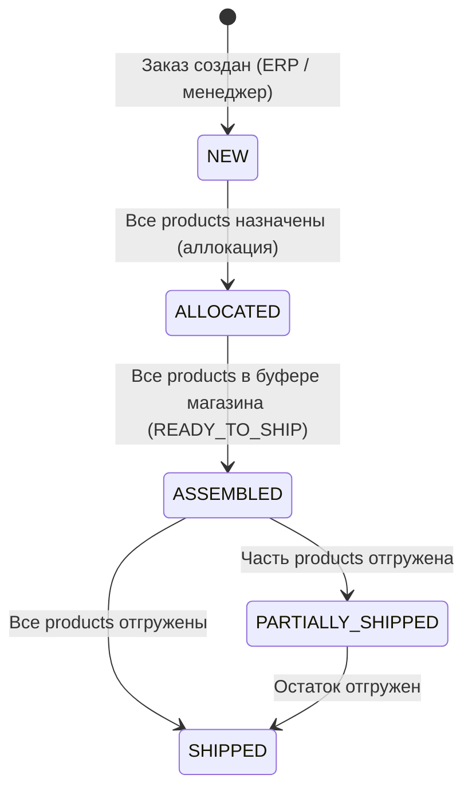

| Переход | Этап WMS | Триггер |
|---------|----------|---------|
| — → NEW | — | Создание заказа |
| NEW → ALLOCATED | Сборка | POST /assembly/allocate (все products назначены) |
| ALLOCATED → ASSEMBLED | Сборка | POST /assembly/scan-shipping-buffer/submit (`UpdateOrdersToAssembled`) |
| ASSEMBLED → PARTIALLY_SHIPPED | Отгрузка | POST /shipping/ship/submit, отгружена часть товаров заказа |
| ASSEMBLED → SHIPPED | Отгрузка | POST /shipping/ship/submit (подписанное Ship-действие, все товары заказа) |
| PARTIALLY_SHIPPED → SHIPPED | Отгрузка | следующий POST /shipping/ship/submit добирает остаток |

---

## assembly_tasks (задача сборки)

Задача подбора одного товара для заказа. Создаётся системой при аллокации.

```mermaid
stateDiagram-v2
    [*] --> PENDING : Аллокация (система)
    PENDING --> IN_PROGRESS : Оператор начал сборку (опционально)
    PENDING --> DONE : Оператор подобрал товар
    IN_PROGRESS --> DONE : Оператор подобрал товар
    PENDING --> CANCELLED : Деаллокация (отмена)
    IN_PROGRESS --> CANCELLED : Деаллокация (отмена)
```

---

## outbound_dispatches (исходящий рейс)

Плановый исходящий рейс, создаваемый внешней логистикой до погрузки. Содержит номер ТС (`vehicle_number`) и другую логистическую информацию. Используется на этапе отгрузки через `dispatch_id`.

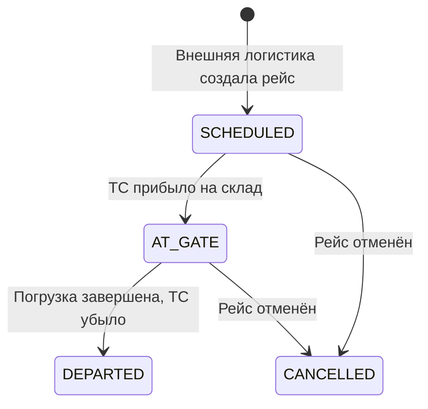

| Переход | Этап WMS | Триггер |
|---------|----------|---------|
| — → SCHEDULED | Подготовка | Внешняя логистика создаёт рейс до погрузки |
| SCHEDULED → AT_GATE | Отгрузка | ТС прибыло на склад |
| AT_GATE → DEPARTED | Отгрузка | Погрузка завершена, ТС убыло |
| SCHEDULED → CANCELLED | — | Оператор отменил рейс |
| AT_GATE → CANCELLED | — | Оператор отменил рейс |

## On-chain статус (SignedMappingWMS.itemStatus)

Параллельный трек жизненного цикла товара на блокчейне. Контракт хранит FSM **на каждый товар**: `itemStatus(itemId)` возвращает текущий статус. Переходы выполняет Ledger Adapter, применяя подписанные действия (`SignedMappingWMS.applyActions`).

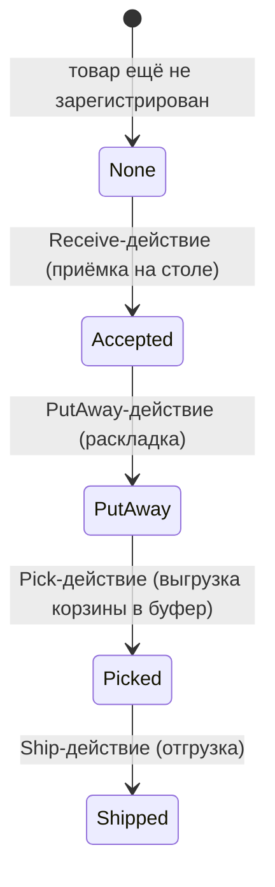

| On-chain переход | Off-chain статус product | Кто вызывает | Транспорт |
|-----------------|------------------------|-------------|-----------|
| None → Accepted | RECEIVED | Ledger Adapter (`applyActions`) | action_type 1, топик wms.events.v1 |
| Accepted → PutAway | STORED | Ledger Adapter (`applyActions`) | action_type 2, топик wms.events.v1 |
| PutAway → Picked | READY_TO_SHIP | Ledger Adapter (`applyActions`) | action_type 3, топик wms.events.v1 |
| Picked → Shipped | SHIPPED | Ledger Adapter (`applyActions`) | action_type 4, топик wms.events.v1 |

Действие применено или отклонено целиком (атомарность на действие); статус каждого его товара меняется отдельным событием `ItemMoved`. Причина отклонения — `reject_reason` в `onchain_events` (ADR-0001 §6).

---

## warehouse_actions (часть подписанной складской операции)

Одна строка — одна часть операции (≤2000 товаров, ADR-0001 §10). Черновик создаётся на `/draft`, после подписания и `/submit` строка помечается отправленной и в outbox уходит конверт действия.

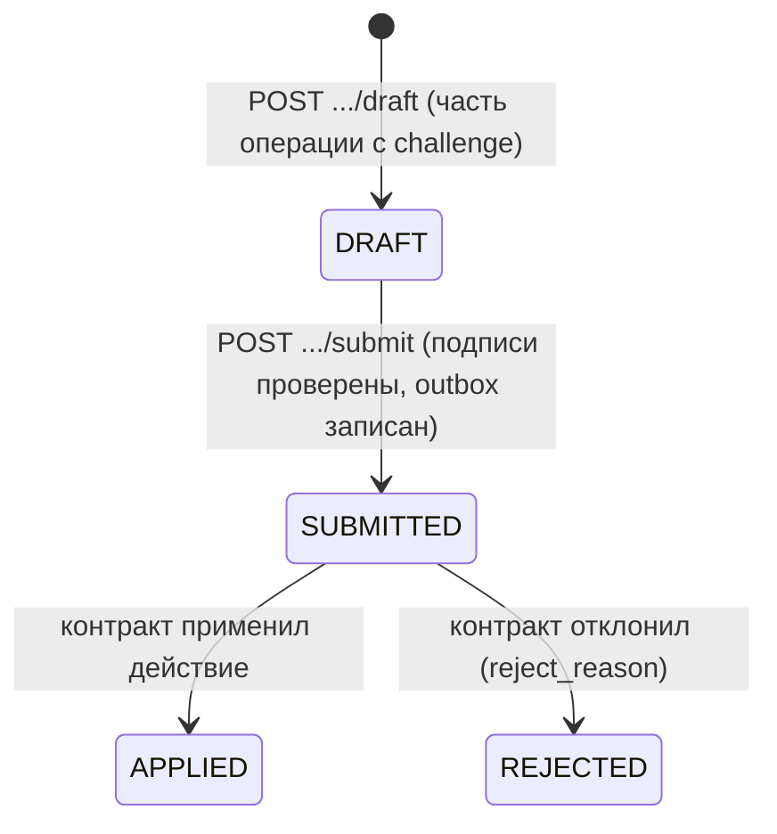

| Переход | Триггер |
|---------|---------|
| — → DRAFT | `POST .../draft` (close-cargoplace, scan-storage-bin, scan-shipping-buffer, ship) |
| DRAFT → SUBMITTED | `POST .../submit`: `submitted_at = now()`, конверт в `outbox_events` |
| SUBMITTED → APPLIED / REJECTED | событие от контракта, отражённое в `onchain_events` (status/reject_reason по `event_id = action_id`) |

---

## key_actions (подписанное ключевое действие)

Регистрация/отзыв ключа оператора админом (ADR-0001 §1). Одна строка — одно действие (без частей).

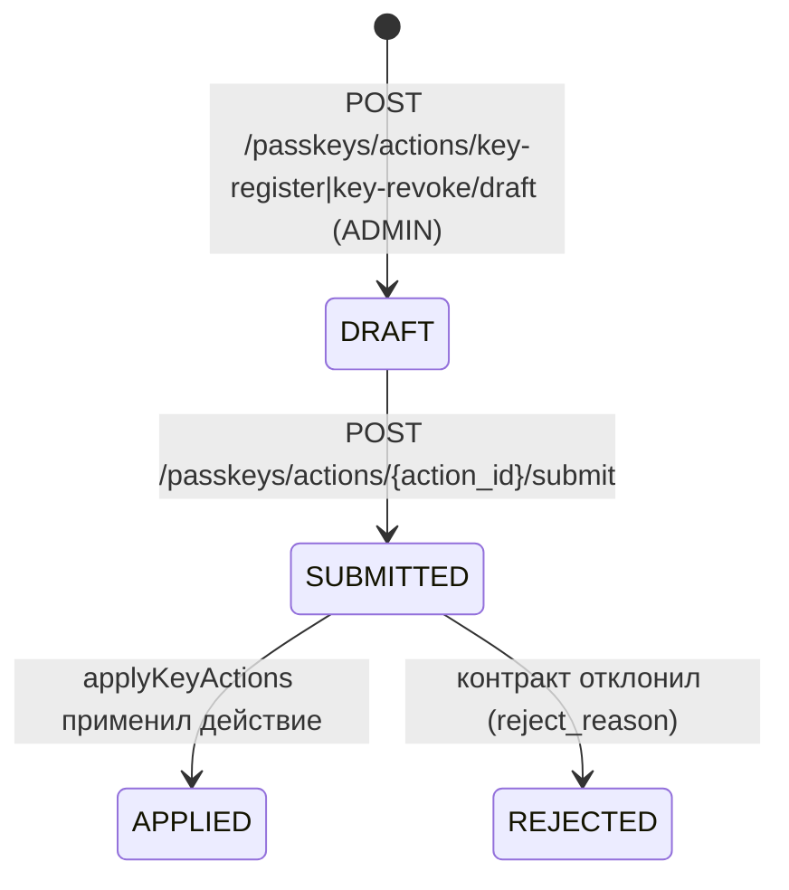

Черновик ключевого действия отменить нельзя — он просто остаётся без `submitted_at`. Незавершённое действие над тем же целевым ключом блокирует новый draft (`ACTION_IN_PROGRESS`); отклонить можно только регистрацию passkey целиком — `POST /passkeys/organization/keys/reject` переводит `PENDING`-ключ в `REJECTED`.

---

## passkey_credentials (passkey пользователя)

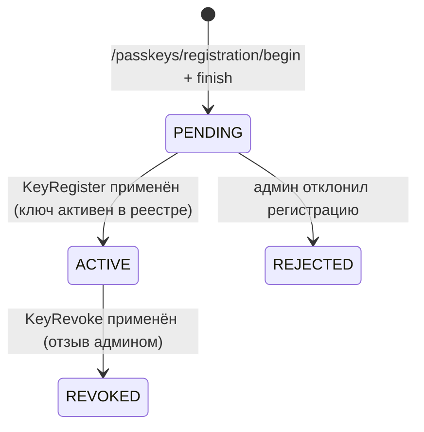

Статус `PENDING`/`ACTIVE` подтягивается из реестра цепи при чтении (`passkeys.syncStatuses` одним батч-запросом: ключ активен → `ACTIVE`, иначе → `REVOKED`); ошибки RPC только логируются, сохранённый статус остаётся. `REJECTED` из цепи не пересматривается. Складские действия подписывает только `ACTIVE`-ключ (гейт `SIGNER_KEY_NOT_ACTIVE`). Роль на момент регистрации: `ADMIN`/`OPERATOR`.

---

## organizations (организация)

Справочник владельцев пользователей и ключей. Регистрируется владельцем консорциума в `ConsortiumRegistry` (root of trust); в WMS — статичная запись: `org_id`, уникальное `name`. Пользователи связаны через `users.org_id`.

---

## onchain_events (статус записи на блокчейн)

Таблица, управляемая Ledger Adapter. Отслеживает прогресс отправки каждого подписанного действия на блокчейн (`event_id = action_id`).

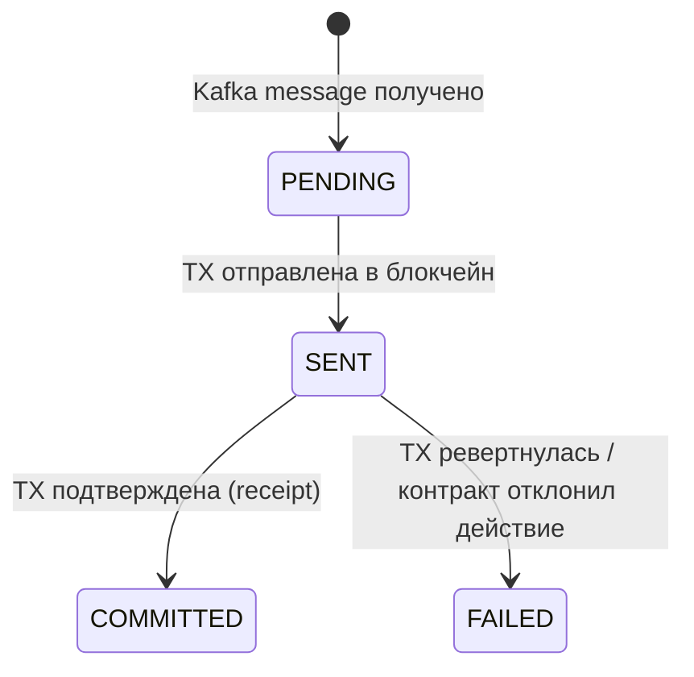

При отклонении контрактом пишется `reject_reason` (код RejectReason, ADR-0001 §6) и `error_message`. Зависшие `SENT`-строки дотягивает reconciler адаптера; `FAILED` — терминальный статус (действие с той же целью можно повторить только новым `action_id`).

---

## Сводная таблица: все сущности и этапы

| Сущность | КПП | Стол | Раскладка | Сборка | Отгрузка |
|----------|-----|------|-----------|--------|----------|
| inbound_shipments | CREATED → GATE_CLOSED | — | — | — | — |
| cargoplaces | EXPECTED → RECEIVED/NOT | → TABLE_CLOSED | — | — | — |
| boxes | — | OPEN → CLOSED | — | — | — |
| products | — | INSERT (RECEIVED) | → STORED | → ALLOCATED → ASSEMBLED → READY_TO_SHIP | → SHIPPED |
| orders | — | — | — | NEW → ALLOCATED → ASSEMBLED | → SHIPPED / PARTIALLY_SHIPPED |
| order_lines | — | — | — | INSERT (создаётся вместе с заказом) | — |
| assembly_tasks | — | — | — | INSERT → DONE | — |
| outbound_dispatches | — | — | — | — | SCHEDULED → AT_GATE → DEPARTED |
| putaways | — | — | INSERT | — | — |
| shippings | — | — | — | — | INSERT (с dispatch_id, action_id) |
| warehouse_actions | — | INSERT (Receive, draft→submit) | INSERT (PutAway) | INSERT (Pick, при выгрузке в буфер) | INSERT (Ship) |
| outbox_events | — | INSERT (1 строка на действие) | INSERT (1 на действие) | INSERT (1 на действие) | INSERT (1 на действие) |
| key_actions / passkey_credentials | — | — | — | — | — (управляются через /passkeys) |
| receiving_gate | INSERT | — | — | — | — |
| receiving_table | — | INSERT | — | — | — |
