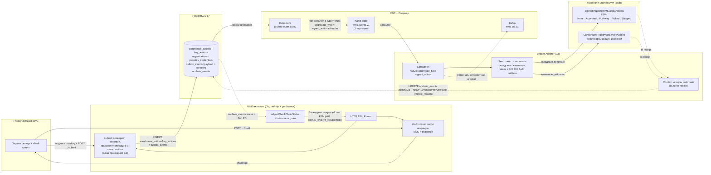

# Документация разработчика

**Проект:** WMS-монолит (Go) + Ledger Adapter (Go) + Avalanche Subnet-EVM
**Назначение документа:** единая точка входа для команды, принимающей проект. Здесь — обзор системы, архитектурная схема, карта всей документации, запуск стенда с реестром, контрактный слой, технологический стек, ключевые принципы и маршрут чтения.

> Это «верхний» индекс пакета «Документация разработчика». Он не дублирует содержимое детальных документов, а связывает их и даёт контекст. Все конкретные эндпоинты, поля таблиц, FSM-переходы и flow-диаграммы описаны в документах, на которые ведут ссылки ниже.

---

## Назначение системы

WMS (Warehouse Management System) управляет жизненным циклом товара на складе через **5 этапов**:

**Приёмка на КПП → Приёмка на столе → Раскладка → Сборка → Отгрузка**

Каждая физическая операция (сканирование TTN, грузоместа, QR-кода товара, ячейки) фиксируется в PostgreSQL. Шаги, меняющие on-chain статус товара, оператор подтверждает **подписанным действием** (passkey, WebAuthn P-256): единица записи в блокчейн — не событие на товар, а одно действие склада (принял грузоместо, разложил корзину, выгрузил корзину сборки в буфер, отгрузил рейс). Цепочка: `draft/submit HTTP-флоу → outbox_events (конверт действия) → Debezium → Kafka → Ledger Adapter → SignedMappingWMS.applyActions` (и `ConsortiumRegistry.applyKeyActions` для ключевых действий — регистрация/отзыв ключей).

Блокчейн используется **не как хранилище данных**, а как независимый верификатор конечного автомата (FSM): он подтверждает, что каждый шаг подписан держателем зарегистрированного ключа («владелец → админ → оператор»), товары в действии перечислены полностью и идут в правильном порядке. Вся «тяжёлая» бизнес-логика и данные остаются в WMS и Postgres; on-chain пишется минимум — `actionId`, `itemId` (хэши UUID), хеш деталей, подпись и переходы статусов.

---

## Архитектурная схема

Прямой путь — от оператора до блокчейна. Обратный путь — статус on-chain записывается в `onchain_events` и читается WMS как «шлюз» (chain-status gate), блокирующий следующий шаг FSM при отклонённом on-chain действии.



**Как читать схему:**

- **Прямой путь (сплошные стрелки):** WMS строит черновик действия (части ≤ 2 000 товаров, у каждой свой `actionId`, соль и challenge), браузер подписывает каждую часть passkey, `submit` проверяет assertion и в **одной транзакции** применяет операцию и пишет строки `outbox_events` (`aggregate_type = signed_action`, `payload` — подписанный конверт). Debezium через `EventRouter` маршрутизирует **все** события в единственный топик `wms.events.v1`, проставляя `aggregate_type` в Kafka-заголовок. Ledger Adapter принимает только `signed_action` (всё остальное — в DLQ), режет окно на подряд идущие сегменты складских и ключевых действий и отправляет их по порядку одной nonce-цепочкой: складские — в `SignedMappingWMS.applyActions`, ключевые — в `ConsortiumRegistry.applyKeyActions`.
- **Обратный путь (пунктир):** адаптер обновляет статус действия в `onchain_events` (`PENDING → SENT → COMMITTED/FAILED`); отклонённое контрактом действие получает `FAILED` + код `reject_reason` (ADR-0001 §6). WMS **читает** `onchain_events` через `ledger.CheckChainStatus` и блокирует следующий шаг FSM, если товар попал в `FAILED`-действие предыдущего этапа. Это не слушатель on-chain-событий, а проверка статуса в Postgres.

> Детальные диаграммы потоков и последовательностей: [DFD](../business-process/data-flow-diagrams.md), [сквозной путь товара](../business-process/end-to-end-flow.md), [маппинг в блокчейн](../integration/blockchain-mapping.md). Первоисточник модели подписанных действий — [ADR-0001](../adr/0001-signed-actions.md).

---

## Карта документации

### Первоисточники и сценарии

| Документ | Описание |
|----------|----------|
| [ADR-0001 «Подписанные складские действия»](../adr/0001-signed-actions.md) | Главный источник истины по модели: контракты, challenge, WebAuthn, семантика применения, замеры газа. |
| [passkeys-runbook.md](passkeys-runbook.md) | Ранбук по ключам: создать passkey, выгрузить ключ админа, зарегистрировать организацию, отозвать и заменить ключ. |
| [openapi.yaml](../api/openapi.yaml) | Машиночитаемая OpenAPI-спецификация всех эндпоинтов WMS. Источник истины для API. |
| [swagger-ui.html](../api/swagger-ui.html) | Интерактивный просмотр спецификации (Swagger UI), открывается в браузере. |
| [api-contract.md](../api/api-contract.md) | Человекочитаемый контракт: request/response, ошибки, побочные эффекты. Сгенерирован из `openapi.yaml`. |

### Код-референс

| Документ | Описание |
|----------|----------|
| [wms-reference.md](wms-reference.md) | Референс WMS-монолита: пакеты, модули (receiving / putaway / assembly / shipping / dispatches / destinations / auth / passkeys / audit), сервисы, репозитории, запись outbox. |
| [ledger-adapter-reference.md](ledger-adapter-reference.md) | Референс Ledger Adapter: consumer, окно/сегменты/чанки, Confirm и reconcile, конфигурация, DLQ, HTTP-эндпоинты. |
| [smart-contract-reference.md](smart-contract-reference.md) | Референс контрактов `ConsortiumRegistry` / `SignedMappingWMS` / библиотеки `SignedAction`: функции, события, коды отклонений, storage. |
| [operations.md](operations.md) | Эксплуатация: docker-compose, переменные окружения, инициализация БД/Kafka, регистрация Debezium-коннектора, мониторинг, CI. |

### Архитектура и бизнес-процессы

| Документ | Описание |
|----------|----------|
| [architecture/system-overview.md](../architecture/system-overview.md) | Обзор архитектуры MVP: компоненты, роли, Kafka, Debezium, блокчейн-слой, безопасность. |
| [business-process/end-to-end-flow.md](../business-process/end-to-end-flow.md) | Сквозной путь товара от ворот до отгрузки. **Начни отсюда.** |
| [business-process/data-flow-diagrams.md](../business-process/data-flow-diagrams.md) | Диаграммы потоков данных (DFD): Level 0 → Level 1 → Level 2. |
| [flows/receiving-gate-flow.md](../flows/receiving-gate-flow.md) | Этап «Приёмка на КПП»: сканирование TTN и грузомест (без outbox). |
| [flows/receiving-table-flow.md](../flows/receiving-table-flow.md) | Этап «Приёмка на столе»: вскрытие грузоместа, создание `products`, подписанное действие `Receive`. |
| [flows/putaway-flow.md](../flows/putaway-flow.md) | Этап «Раскладка»: из буфера в ячейки хранения, подписанное действие `PutAway`. |
| [flows/assembly-flow.md](../flows/assembly-flow.md) | Этап «Сборка»: аллокация и подбор товаров, подписанное действие `Pick`. |
| [flows/shipping-flow.md](../flows/shipping-flow.md) | Этап «Отгрузка»: верификация и отправка заказа, подписанное действие `Ship`. |
| [data-model/entity-lifecycle.md](../data-model/entity-lifecycle.md) | Жизненные циклы сущностей: все статусы и переходы в одном месте. |
| [data-model/er-diagram.md](../data-model/er-diagram.md) | ER-диаграмма: связи между таблицами, уникальные ограничения. |
| [db/Database_ru_v2.md](../db/Database_ru_v2.md) | Подробная схема БД: все поля всех таблиц с описаниями (схемы `public`, `wms_inventory`, `wms_ops`). |
| [integration/blockchain-mapping.md](../integration/blockchain-mapping.md) | Маппинг WMS → блокчейн: какая операция что пишет, полный путь события. |
| [integration/data-contract.md](../integration/data-contract.md) | Контракт данных: формат outbox, Kafka, Ledger Adapter, `onchain_events`. |
| [integration/batch-mapping-approach.md](../integration/batch-mapping-approach.md) | Исторический подход v1 (событие на товар): сравнение альтернатив и нагрузочные замеры. |
| [CONVENTIONS.md](../CONVENTIONS.md) | Конвенции проекта: git workflow, Go style, SQL naming, Docker. |
| [MR_GUIDE.md](../MR_GUIDE.md) | Правила оформления merge requests. |

---

## Стенд с реестром: первый запуск

Минимальный путь «поднял стек → зарегистрировал организацию → подтвердил ключи». Ключи операторов и складские действия живут поверх реестра: пока ключ оператора не подтверждён админом в цепи, складские шаги бэкенд не принимает.

### 1. Поднять стек

```bash
cp .env.example .env
# отредактируйте JWT_SECRET (см. operations.md §1.2 — без этого стек не стартует)
docker compose --profile test up -d --build   # полный стек с локальной цепью
make ps                                       # дождаться healthy у postgres/kafka/subnet-node1
make connector-status                         # CDC: коннектор регистрирует one-shot connector-init
```

`make up` поднимает только приложение и инфраструктуру без профиля `test` — локальной цепи, `contract-deploy` и он-чейн части в этом режиме нет. Перерегистрировать Debezium-коннектор вручную (например, после правки `postgres-connector.json`) — `make register-connector`.

Вариант с внешним KMS-подписантом — `make kms-up` (Web3Signer, приватник адаптера не попадает в процесс); детали — [operations.md](operations.md) и [ledger-adapter/README.md](../../ledger-adapter/README.md). Фронтенд: `cd frontend && npm ci && npm run dev` → `http://localhost:5173`.

### 2. Откуда адреса контрактов и ключ владельца

На свежей цепи one-shot `contract-deploy` (скрипт [deploy/contracts/deploy.sh](../../deploy/contracts/deploy.sh)) деплоит ключом ewoq сначала `ConsortiumRegistry` (nonce 0), затем `SignedMappingWMS` с адресом реестра в конструкторе (nonce 1) и пишет в том `shared_state`:

| Файл | Содержимое | Кто читает |
|------|-----------|------------|
| `/shared/rpc_url.txt` | динамический RPC `/ext/bc/<blockchainID>/rpc` | ledger-adapter, registry-cli |
| `/shared/registry_addr.txt` | адрес `ConsortiumRegistry` | ledger-adapter (`REGISTRY_ADDR_FILE`), registry-cli |
| `/shared/contract_addr.txt` | адрес `SignedMappingWMS` | ledger-adapter (`CONTRACT_ADDR_FILE`) |
| `/shared/deployer_key.txt` | ключ ewoq — он же **владелец реестра** | ledger-adapter (`PRIVATE_KEY_FILE`), registry-cli (`OWNER_KEY_FILE`) |

Посмотреть адреса (том compose называет по каталогу репозитория — `<каталог>_shared_state`):

```bash
docker run --rm -v "$(basename "$PWD")_shared_state:/shared:ro" alpine:3 \
  sh -c 'cat /shared/rpc_url.txt /shared/registry_addr.txt /shared/contract_addr.txt'
```

`contract-deploy` идемпотентен: при живом байткоде не передеплоит. Полный сброс цепи и БД: `docker compose --profile test down -v` — после него организацию регистрируют заново.

### 3. Зарегистрировать первую организацию

Пользователи из сида: `admin`/`admin` (из `ADMIN_PASSWORD`) и `operator`/`operator`, оба в организации «Демо-склад» (`orgId 01929c5e-0000-7000-8000-00000000a001`).

1. Залогинься как `admin` → меню **«Мой ключ»** (`/passkey`) → **«Создать ключ»** (браузер спросит аутентификатор; статус станет «Ожидает подтверждения»).
2. Меню **«Ключи организации»** (`/organization/keys`) → **«Скачать ключ админа»** — скачается `org-<orgId>.json` (`{"orgId":…,"name":…,"qx":…,"qy":…}` — публичный P-256 ключ админа).
3. Скопируй файл в корень репозитория и зарегистрируй организацию владельцем контракта:

```bash
cp ~/Downloads/org-01929c5e-0000-7000-8000-00000000a001.json ./org.json
make registry-cli ARGS="register-org --file org.json"   # организация зарегистрирована, ключ админа 0x…, tx 0x…
make registry-cli ARGS="list"                            # реестр: организации и ключи (роль, активен/отозван)
```

CLI (`ledger-adapter/cmd/registry-cli`, запускается из образа адаптера целью `registry-cli`) перед отправкой проверяет, что организация и ключ ещё не зарегистрированы; транзакции подписывает ключ из `/shared/deployer_key.txt`. После регистрации «Мой ключ» показывает «Активен в цепи» (статус перечитывается из реестра при каждой загрузке страницы). Файл можно собрать и руками — формат тот же.

### 4. Подтвердить ключи операторов

Оператор создаёт себе ключ на «Мой ключ» (статус «Ожидает подтверждения»). Админ подтверждает его в **«Ключи организации»**: бэкенд строит черновик ключевого действия (`KeyRegister`), админ подписывает его своим passkey, действие уходит в outbox, адаптер применяет `ConsortiumRegistry.applyKeyActions` — после коммита ключ оператора активен в цепи и может подписывать складские действия. Там же админ отзывает ключ оператора (`KeyRevoke`) и отклоняет неподтверждённый ключ. Подробный сценарий, включая аварийный отзыв владельцем (`revokeKey` через `cast`), — [passkeys-runbook.md](passkeys-runbook.md).

---

## Контракты

Источник — каталог `ledger-adapter/contracts/`; полный референс функций и событий — [smart-contract-reference.md](smart-contract-reference.md), модель действий — [ADR-0001](../adr/0001-signed-actions.md).

| Файл | Роль |
|------|------|
| `SignedAction.sol` | Общая библиотека: типы `Type`/`State`/`RejectReason`, `TYPEHASH`, расчёт `challenge` и `keyId`. Коды перечислений входят в подпись — менять нельзя. |
| `ConsortiumRegistry.sol` | Реестр: организации и ключи. Владелец (деплоер) регистрирует организацию с ключом админа; админ подписанными ключевыми действиями регистрирует/отзывает ключи операторов. |
| `SignedMappingWMS.sol` | FSM-контракт v2: `applyActions` проверяет подпись через реестр и двигает статусы товаров; эмитит `ActionApplied`/`ItemMoved`/`ActionRejected`. |
| `BatchMappingWMS.sol` | Старый контракт v1 (событие на товар), сохранён только как базовая линия для гео-бенчмарка (`deploy/geo`); адаптер его не использует. |

**Сборка и тесты:**

- solc **0.8.28**, `evm_version = cancun` (`ledger-adapter/contracts/foundry.toml`) — нужны WebAuthn из OpenZeppelin 5.7 (`mcopy`); subnet-evm 0.8.0 исполняет cancun.
- OpenZeppelin Contracts 5.7.0 вендорится в `ledger-adapter/contracts/deps/openzeppelin-contracts/` (remapping `@openzeppelin/contracts/` → `deps/…`), только файлы, которые импортируют контракты.
- `forge-std` не вендорится: перед первым `forge test` склонируй его (каталог `ledger-adapter/contracts/lib/` в `.gitignore`, для деплоя не нужен):

```bash
cd ledger-adapter/contracts
git clone --depth 1 https://github.com/foundry-rs/forge-std lib/forge-std   # один раз
forge test        # контракт-тесты + прогон тест-векторов testdata/signed-actions/vectors.v1.json
```

- **Газ мерить только на узле.** В `forge test` precompile secp256r1 (`0x100`, RIP-7212) недоступен: OpenZeppelin переходит на проверку подписи на Solidity, и подпись стоит ~290 тыс. газа вместо ~7 тыс. на живом узле. Замеры — скриптом GasBench против реального RPC (ADR-0001 §11 и «Замеры газа»):

```bash
forge script script/GasBench.s.sol:GasBench --rpc-url <RPC> --private-key <ключ с балансом> --broadcast --slow
PROBE_ITEMS=4060 forge script script/GasBench.s.sol:GasBench --rpc-url <RPC> --private-key <ключ> --broadcast --slow  # предельное действие
```

- **ABI обновляется вручную** в двух копиях — `ledger-adapter/internal/chain/` (адаптер) и `wms/internal/audit/` (аудит в WMS); копии обязаны быть идентичны. После изменения контракта (команды из `ledger-adapter/contracts`; `forge-std` нужен и здесь — `forge build` компилирует тесты и скрипты):

```bash
cd ledger-adapter/contracts
forge build
jq -c '.abi' out/SignedMappingWMS.sol/SignedMappingWMS.json > ../internal/chain/SignedMappingWMS.abi.json
jq -c '.abi' out/ConsortiumRegistry.sol/ConsortiumRegistry.json > ../internal/chain/ConsortiumRegistry.abi.json
cp ../internal/chain/SignedMappingWMS.abi.json ../internal/chain/ConsortiumRegistry.abi.json ../../wms/internal/audit/
```

---

## Технологический стек

| Слой | Технология | Примечание |
|------|-----------|-----------|
| Frontend | React (SPA), сканер-интерфейсы | RU-локализованные экраны, JWT-авторизация, WebAuthn-подпись действий |
| WMS-монолит | Go, `net/http` + `gorilla/mux` | Без префикса `/api/v1`; маршруты вида `/receiving/...`, `/auth/login`, `/health` |
| Авторизация | JWT (HS256), bcrypt | Роли `ADMIN` / `OPERATOR` / `AUDITOR` / `CUSTOMER`; access 15m, refresh 168h |
| Ключи операторов | Passkey (WebAuthn, ES256) | Сервер хранит только публичный ключ (`qx`,`qy`) и `keyId`; приватный — на устройстве оператора |
| БД | PostgreSQL 17 | 3 схемы: `public`, `wms_inventory`, `wms_ops`; `wal_level=logical` для CDC |
| Драйвер БД | `pgx` / `pgxpool` | Пул: MinConns=2, MaxConns=10 (захардкожено) |
| CDC | Debezium (`debezium/connect:2.6`) | `EventRouter` SMT, плагин `pgoutput`, `publication = outbox_publication`, payload из колонки `payload` |
| Очереди | Apache Kafka 3.7 (KRaft) | Единственный рабочий топик `wms.events.v1` (1 партиция), DLQ `wms.dlq.v1` |
| Мост в блокчейн | Ledger Adapter (Go) | Kafka consumer + окно/сегменты/чанки + Confirm + reconcile-loop |
| EVM-клиент | `go-ethereum` (`ethclient`, `abi`) | Подпись tx (один signer), ожидание квитанций |
| Блокчейн | Avalanche Subnet-EVM | Локально — узел `subnet-node1` (avalanchego v1.14.0 + плагин subnet-evm, кастомный сабнет chainID `99999`, профиль `test`); precompile secp256r1 (`0x100`); пермиссионные Allow Lists реализованы — см. `deploy/subnet/README.md`, раздел Allow-list |
| Контракт | `ConsortiumRegistry` + `SignedMappingWMS` (Solidity 0.8.28) | Foundry, EVM target `cancun`, optimizer 200 runs; OpenZeppelin 5.7 вендорится |
| Инфраструктура | Docker Compose | WMS, ledger-adapter, postgres, kafka, debezium, мониторинг |
| Мониторинг | Prometheus + Grafana + exporters | postgres-exporter, JMX-экспортеры Kafka/Debezium |
| CI | GitLab CI | Стадии `lint → test → build_&_deploy`, golangci-lint, `go test -race` |

---

## Ключевые архитектурные принципы

1. **Outbox pattern.** WMS пишет только в PostgreSQL. Бизнес-запись и строка `outbox_events` создаются **в одной транзакции** — нет двойной записи в БД и Kafka. Debezium подхватывает `outbox_events` и публикует в Kafka. При недоступности Debezium/Kafka событие уже надёжно лежит в БД.

2. **1 outbox event = 1 подписанное действие.** `event_id = aggregate_id = actionId`, `aggregate_type = 'signed_action'`, `event_type = 'wms.action.v1'`, `payload` — подписанный конверт (ADR-0001 §9). Складские шаги пишут строку в `warehouse_actions` (типы 1 Receive / 2 PutAway / 3 Pick / 4 Ship), ключевые — в `key_actions` (5 KeyRegister / 6 KeyRevoke). Одна операция крупнее 2 000 товаров нарезается бэкендом на части — у каждой свой `actionId` и подпись.

3. **Блокчейн = верификатор FSM, не хранилище.** `SignedMappingWMS` ведёт строгий конечный автомат `None → Accepted → PutAway → Picked → Shipped` и проверяет подпись каждого действия через `ConsortiumRegistry`. Контракт ничего не хранит о бизнес-деталях — только `itemStatus`, `actionState` и события. Действие применяется или отклоняется **целиком** (сначала проверяются все товары, потом пишутся); транзакция с батчем действий не ревертится из-за одного отклонённого действия.

4. **Подпись — над складским фактом, не над транзакцией.** Challenge = `keccak256(TYPEHASH, actionId, actionType, itemsHash, detailsHash)` — без `chainId` и адреса контракта: действие переносимо между леджерами. Повтор `actionId` на цепи блокируется `actionState`. Подробности — [ADR-0001 §3–5](../adr/0001-signed-actions.md).

5. **Порядок и идемпотентность на каждом уровне.** Одна партиция Kafka + один signer адаптера: порядок действий в цепи равен порядку коммитов в БД (на этом держится семантика отзыва ключа, ADR §7). В БД `event_id` уникален и трекается в `onchain_events`; on-chain повтор `actionId` пропускается молча по `actionState`.

6. **КПП не пишет в блокчейн.** На этапе «Приёмка на КПП» товары ещё не существуют — они создаются на этапе «Приёмка на столе». Первое складское действие (`Receive`) появляется при закрытии грузоместа на столе.

> Дополнительно: chain-status gate (`ledger.CheckChainStatus`) блокирует следующий шаг FSM, если товар попал в on-chain действие со статусом `FAILED` (`CHAIN_EVENT_REJECTED`, HTTP 409). Это связывает off-chain FSM с on-chain верификатором.

---

## С чего начать новой команде

Рекомендуемый маршрут чтения — от бизнес-обзора к коду:

1. **[Сквозной путь товара](../business-process/end-to-end-flow.md)** — как система работает глазами оператора, от ворот до отгрузки. Самый быстрый способ понять домен.
2. **[ADR-0001](../adr/0001-signed-actions.md)** — модель подписанных действий: контракты, challenge, WebAuthn, семантика применения. Без неё код контрактов и адаптера не читается.
3. **[Жизненные циклы сущностей](../data-model/entity-lifecycle.md)** — все статусы и переходы (`products`, `cargoplaces`, `orders`, `dispatches`). Без этого детали API не складываются в картину.
4. **[Архитектура MVP](../architecture/system-overview.md)** + **[DFD](../business-process/data-flow-diagrams.md)** — компоненты, границы, потоки данных.
5. **[Маппинг WMS → блокчейн](../integration/blockchain-mapping.md)** + **[контракт данных](../integration/data-contract.md)** — как off-chain становится on-chain через outbox → Debezium → Kafka → adapter.
6. **API:** [api-contract.md](../api/api-contract.md) и интерактивный [swagger-ui.html](../api/swagger-ui.html) — конкретные эндпоинты для интеграции и фронтенда.
7. **Код-референс:** [wms-reference.md](wms-reference.md) → [ledger-adapter-reference.md](ledger-adapter-reference.md) → [smart-contract-reference.md](smart-contract-reference.md) — структура кода для продолжения разработки.
8. **Запуск и эксплуатация:** [operations.md](operations.md) и раздел «Стенд с реестром: первый запуск» выше — чтобы поднять стек и завести первую организацию. Ключи и passkey — [passkeys-runbook.md](passkeys-runbook.md).
9. **Перед первым MR:** [CONVENTIONS.md](../CONVENTIONS.md) и [MR_GUIDE.md](../MR_GUIDE.md) — git-workflow, стиль кода, правила ревью (хуки проверяют автоматически).

---

## Глоссарий ключевых терминов

| Термин | Расшифровка |
|--------|-------------|
| **TTN** | Товарно-транспортная накладная. Документ поставки; сканируется на КПП, идентифицирует входящий `shipment`. |
| **Грузоместо / cargoplace** | Физическая единица поставки (палета, короб-контейнер), внутри которой едут коробки с товарами. Проходит этапы КПП и стола приёмки. |
| **SKU** | Stock Keeping Unit — позиция номенклатуры (артикул товара). Связывается со штрихкодами; по `barcode` находится `sku`. |
| **Product** | Конкретный физический экземпляр товара с уникальным QR-кодом. Создаётся на столе приёмки; проходит статусы `RECEIVED → STORED → ALLOCATED → ASSEMBLED → SHIPPED`. В цепи — `itemId = uint256(keccak256(uuid))`. |
| **Действие (action)** | Единица записи в блокчейн: одно подтверждение оператора или админа (закрыл грузоместо, разложил корзину, выгрузил корзину сборки в буфер, отгрузил рейс; для админа — зарегистрировал/отозвал ключ). Товаров в действии может быть до 2 000. |
| **Подписанное действие (signed action)** | Действие, подписанное passkey: конверт (ADR-0001 §9) с `actionId`, типом, списком `itemIds`, `detailsHash`, ключом подписанта и WebAuthn-assertion. В БД — строка `outbox_events` c `aggregate_type='signed_action'` и `payload`-конвертом; в цепи применяется `applyActions`/`applyKeyActions`. |
| **Ключевое действие (key action)** | Подписанное действие над ключами: `KeyRegister` (админ регистрирует ключ оператора своей организации) или `KeyRevoke` (админ отзывает ключ оператора). Черновик — в `public.key_actions`; в цепь уходит через `ConsortiumRegistry.applyKeyActions`. |
| **Passkey** | WebAuthn-учётные данные (P-256/ES256) пользователя. Сервер хранит публичный ключ (`qx`, `qy`) и `keyId = keccak256(qx ‖ qy)` в `passkey_credentials`; приватный ключ остаётся на аутентификаторе. |
| **Registry (`ConsortiumRegistry`)** | On-chain реестр консорциума: организации (`orgId`, имя) и ключи с ролями `Admin`/`Operator`. Владелец контракта — корень доверия; админов регистрирует владелец, операторов — админ подписанными действиями. |
| **Роли (ADMIN / OPERATOR / AUDITOR / CUSTOMER)** | Роли пользователей WMS; в реестре у ключей только `Admin` и `Operator`. Админ подтверждает/отзывает ключи операторов; складские действия может подписать любой активный ключ; ключевые — только ключ админа. `AUDITOR` читает сверку (страница `/audit`). |
| **Putaway / Раскладка** | Перемещение товаров из приёмочного буфера в ячейки хранения. Подписанное действие `PutAway`, статус `RECEIVED → STORED`. |
| **Assembly / Picking / Сборка** | Аллокация заказов на товары + физический подбор по QR. Подписанное действие `Pick` (выгрузка корзины сборки в буфер отгрузки), статус `STORED → ALLOCATED → ASSEMBLED`. |
| **Dispatch / Рейс** | Запланированная отгрузка (машина + водитель + направление). Создаётся в модуле `dispatches`; отгрузка рейса — подписанное действие `Ship`. |
| **Outbox** | Таблица `public.outbox_events`. WMS пишет в неё событие в одной транзакции с бизнес-записью. У подписанного действия: `event_id = aggregate_id = actionId`, `aggregate_type = 'signed_action'`, `event_type = 'wms.action.v1'`, `payload_hash` — challenge (64 hex-символа без `0x`), `payload` — конверт. |
| **CDC (Change Data Capture)** | Захват изменений БД. Здесь — Debezium читает WAL Postgres (logical replication) и публикует строки `outbox_events` в Kafka без участия приложения. |
| **onchain_events** | Таблица в `public`. Ledger Adapter ведёт в ней статус каждого on-chain действия (`PENDING → SENT → COMMITTED/FAILED`); у отклонённых контрактом действий заполнен `reject_reason` (код ADR-0001 §6). WMS читает её через `ledger.CheckChainStatus` для блокировки следующего шага при `FAILED`. |
| **Chain-status gate** | Проверка WMS перед следующим шагом FSM: товар, попавший в `FAILED`-действие предыдущего этапа, блокируется (HTTP 409 `CHAIN_EVENT_REJECTED`). |
| **Flusher** | Компонент Ledger Adapter: режет окно сообщений на сегменты складских/ключевых действий, чанки по calldata, отправляет одной nonce-цепочкой и Confirm'ит по receipt'ам. |
| **DLQ** | Dead Letter Queue (`wms.dlq.v1`). Сюда уходят непарсящиеся сообщения, неизвестные агрегаты и терминально failed-батчи для разбора. |
