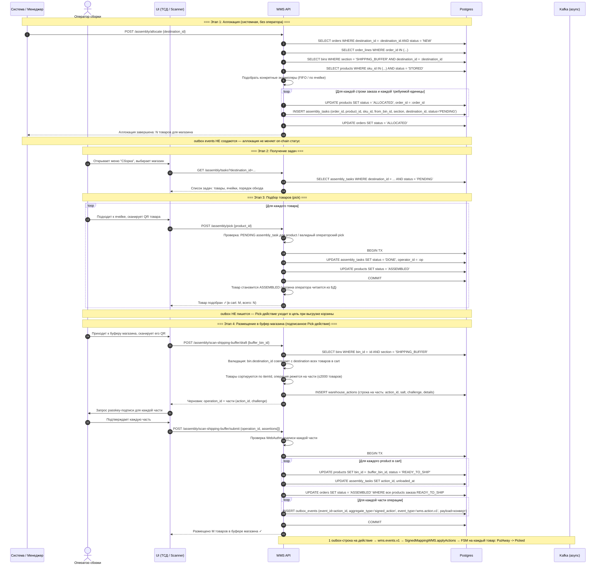
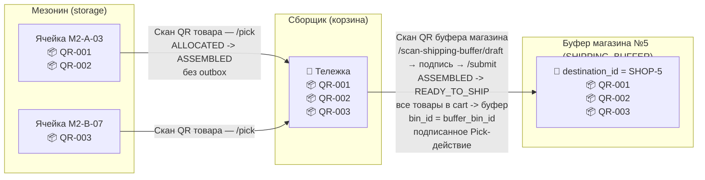
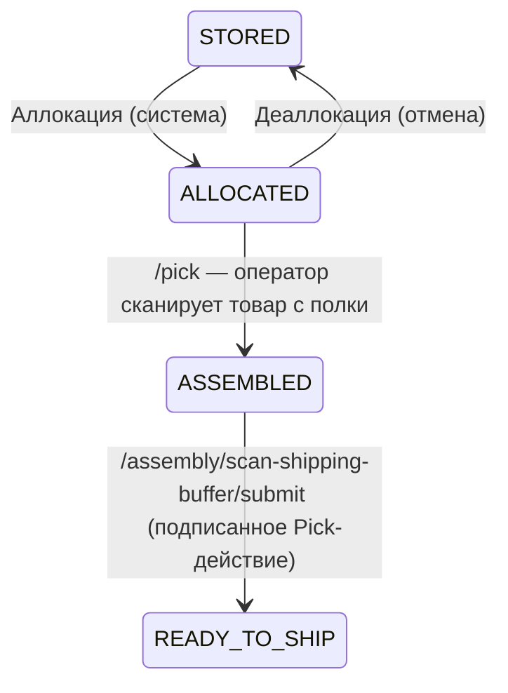
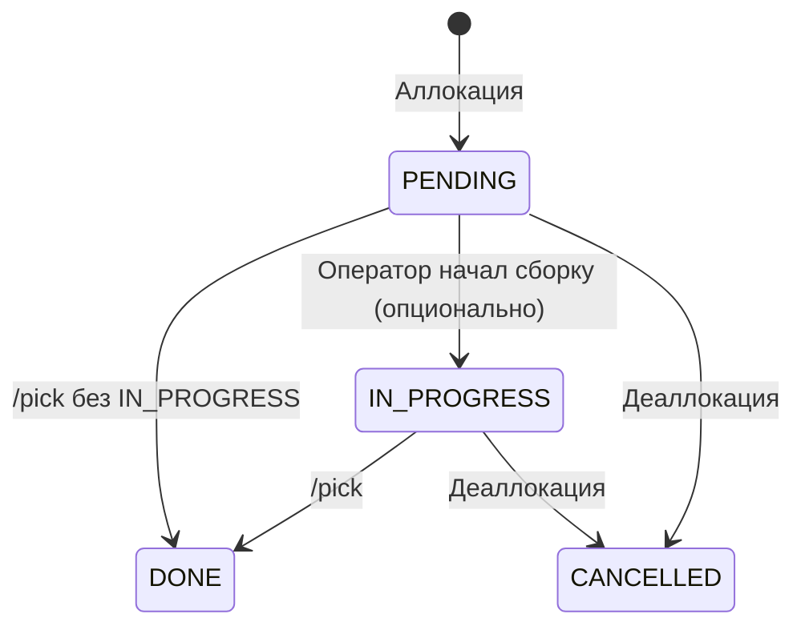
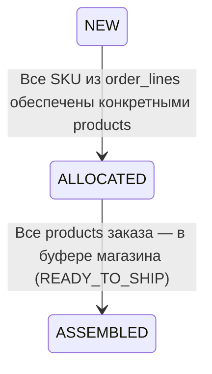
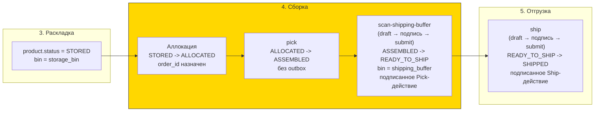

# Сборка заказа (Assembly / Picking)

## Суть

Подбор товаров для отгрузки в конкретный магазин. Поток работает **по магазинам (`destination_id`)**: система читает `NEW` заказы и их `order_lines`, аллоцирует конкретные `products`, создаёт `assembly_tasks`, а оператор физически подбирает товары и переносит их в `SHIPPING_BUFFER` этого магазина.

**Ключевое:**

- `order_lines` определяют, какие SKU и в каком количестве нужно собрать.
- `orders.destination_id` фиксирует магазин-получатель.
- `assembly_tasks.destination_id` денормализует магазин в задачу, чтобы оператор работал с пачкой задач для одного destination.
- `SHIPPING_BUFFER` закреплён за конкретным `destination_id` и используется как staging исходящего потока.
- `pick` — физическая операция оператора: товар → `ASSEMBLED`, задача → `DONE`. **On-chain записи нет** — Pick-действие уходит в цепь позже, при выгрузке корзины в буфер.
- `scan-shipping-buffer` — выгрузка корзины в буфер магазина: **подписанное действие** (draft → passkey → submit), on-chain переход `PutAway -> Picked`, 1 строка outbox на действие-часть.
- Паттерн симметричен раскладке (putaway), только в обратную сторону: `storage -> cart -> shipping_buffer` вместо `buffer -> cart -> storage`.

### Три этапа

1. **Аллокация** (системная) — система находит `NEW` заказы для магазина, читает `order_lines`, подбирает `STORED` products по SKU и создаёт `assembly_tasks`.
2. **Подбор (pick)** — оператор обходит полки, сканирует QR каждого товара. Товар становится `ASSEMBLED` (корзина — DB-derived: ASSEMBLED-товары оператора с DONE-задачей). On-chain записи нет.
3. **Размещение в буфер магазина** — оператор приходит в зону буфера, сканирует его. Все товары из cart попадают в буфер, статус товара переходит в `READY_TO_SHIP`. Одно подписанное Pick-действие (draft → passkey → submit) уходит в цепь.

## Диаграмма последовательности



## Физический процесс



## Состояния сущностей

### products.status (в контексте сборки)



Промежуточный статус `ASSEMBLED` означает «товар в руках сборщика, ещё не доставлен в буфер». После `scan-shipping-buffer` товар физически лежит в `SHIPPING_BUFFER` bin и ждёт машину.

### assembly_tasks.status



### orders.status (в контексте сборки)



**Важно:** `orders.status = ASSEMBLED` наступает **когда все products заказа уже в буфере** после `scan-shipping-buffer`, а не когда они просто подобраны в статус `ASSEMBLED`. До этого заказ остаётся в `ALLOCATED`.

## Какие таблицы затрагиваются

| Таблица | Операция | Этап | Что меняется |
|---------|----------|------|--------------|
| `orders` | SELECT / UPDATE | Аллокация -> сборка | Читается `destination_id`, статус `NEW -> ALLOCATED -> ASSEMBLED` |
| `order_lines` | SELECT | Аллокация | Источник потребности по SKU и количеству |
| `products.status` | UPDATE | Аллокация | `STORED -> ALLOCATED` |
| `products.status` | UPDATE | `/pick` | `ALLOCATED -> ASSEMBLED` |
| `products.status` | UPDATE | `/scan-shipping-buffer/submit` | `ASSEMBLED -> READY_TO_SHIP` |
| `products.order_id` | UPDATE | Аллокация | `NULL -> :order_id` |
| `products.bin_id` | UPDATE | `/scan-shipping-buffer/submit` | `storage_bin -> shipping_buffer_bin` |
| `assembly_tasks` | INSERT | Аллокация | Создание задач подбора с `destination_id`, `status = PENDING` |
| `assembly_tasks` | UPDATE | `/pick` | `status: PENDING/IN_PROGRESS -> DONE`, `operator_id` |
| `assembly_tasks` | UPDATE | `/scan-shipping-buffer/submit` | `action_id` (ссылка на подписанное Pick-действие), `unloaded_at` |
| `warehouse_actions` | INSERT | `/scan-shipping-buffer/draft` | Строка на каждую часть Pick-операции |
| `bins` | SELECT | Аллокация / буфер | Обычные storage bins и destination-specific `SHIPPING_BUFFER` |
| `outbox_events` | INSERT | **только `/scan-shipping-buffer/submit`** | 1 строка на действие-часть, `aggregate_type = 'signed_action'` |

## Outbox events

Создаются **только при `POST /assembly/scan-shipping-buffer/submit`**, в той же транзакции, что и перемещение товаров в буфер — **по одной строке на действие-часть** (операция режется на части по ≤2000 товаров, у каждой свой `action_id`):

```sql
-- после проверки всех passkey-подписей, для каждой части операции:
INSERT INTO outbox_events (event_id, aggregate_id, aggregate_type, event_type, payload_hash, payload)
VALUES (
  action_id,                 -- = warehouse_actions.action_id
  action_id,
  'signed_action',
  'wms.action.v1',
  challenge (hex),
  подписанный конверт (ADR-0001 §9)
);
```

**Блокчейн:** Ledger Adapter публикует действия в `SignedMappingWMS.applyActions` → проверка подписи (precompile P-256) → FSM на каждый товар: переход `PutAway -> Picked`.

**При `/assembly/pick` outbox НЕ создаётся** — подбор товара с полки меняет только off-chain статусы. On-chain переход `PutAway -> Picked` происходит одним подписанным действием при выгрузке корзины в буфер магазина.

## Корзина оператора

Корзина — **не in-memory структура, а запрос к БД**: `ASSEMBLED`-товары оператора с DONE-задачей (`CountAssembledByOperator`, `ListOperatorBasket`). Поэтому `cart_size` в ответе `/assembly/pick` и состав корзины переживают рестарт WMS и горизонтальное масштабирование.

- Наполняется при каждом успешном `/assembly/pick` (товар становится `ASSEMBLED`, задача — `DONE`).
- Состав фиксируется в черновике `/assembly/scan-shipping-buffer/draft` и сверяется на `/submit` (расхождение → `DRAFT_STALE`).
- После `/submit` товары уже в `READY_TO_SHIP`, в буфере — в корзину больше не попадают.

**Частичная сдача поддерживается:** оператор может собрать 5 товаров и сразу отнести в буфер, потом собрать ещё 10 и отнести снова. Каждый цикл `pick` + `scan-shipping-buffer` + `submit` независим.

## Валидации

| Условие | Ошибка |
|---------|--------|
| `/allocate`: нет `SHIPPING_BUFFER` для `destination_id` | `SHIPPING_BUFFER_NOT_FOUND` |
| `/allocate`: недостаточно `STORED` products по SKU | `INSUFFICIENT_STOCK` |
| `/allocate`: заказ уже в статусе != `NEW` | `ORDER_NOT_NEW` |
| `/pick`: `product.status != ALLOCATED` | `PRODUCT_NOT_ALLOCATED` |
| `/pick`: нет `PENDING` / `IN_PROGRESS` assembly_task для product | `NO_TASK_FOR_PRODUCT` |
| `/pick`: `FAILED` PutAway-действие товара в цепи | `CHAIN_EVENT_REJECTED` |
| `/scan-shipping-buffer/draft`: оператор не несёт ASSEMBLED товаров (ничего не подобрано / уже размещено) | `CART_EMPTY` |
| `/scan-shipping-buffer/draft`: `bin.section != 'SHIPPING_BUFFER'` | `BIN_NOT_SHIPPING_BUFFER` (400) |
| `/scan-shipping-buffer/draft`: оператор несёт ASSEMBLED товары, но для другого `destination_id`, чем у буфера | `DESTINATION_MISMATCH` |
| `/scan-shipping-buffer/submit`: состав корзины изменился после подписи | `DRAFT_STALE` |

`DESTINATION_MISMATCH` защищает от ситуации «сборщик собирал для магазина №5, а сканирует буфер магазина №7». Механика: `ListOperatorBasket` фильтрует корзину по `assembly_task.destination_id = bin.destination_id`, поэтому для чужого буфера корзина пуста. Сервис различает два случая через `CountAssembledByOperator`: если у оператора **есть** ASSEMBLED товары (для другого магазина) → `DESTINATION_MISMATCH`; если ASSEMBLED товаров нет вовсе → `CART_EMPTY`. Ни один товар чужого магазина не попадает в буфер (защита от mis-delivery).

## Связь с соседними этапами


