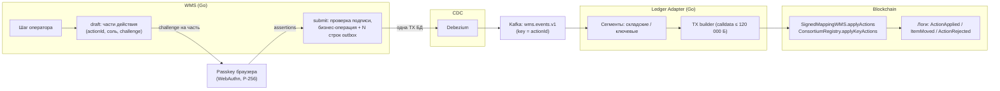

# Маппинг: WMS → Блокчейн (подписанные действия)

**Версия:** 2.0
**Дата:** 2026-11
**Первоисточник:** [ADR-0001 «Подписанные складские действия»](../adr/0001-signed-actions.md)

Этот документ описывает, как каждый шаг WMS превращается в запись на блокчейне. Полный путь: операция → черновик (`draft`) → подпись passkey в браузере → `submit` → outbox → Debezium → Kafka (`wms.events.v1`) → Ledger Adapter → `SignedMappingWMS.applyActions` / `ConsortiumRegistry.applyKeyActions`. Форматы данных на каждом стыке — в [Контракте данных](data-contract.md).

---

## Общая схема

Ключевое отличие от старого пути (до #19): единица записи — **действие**, а не событие на товар. Одна строка outbox на действие, одна подпись оператора на часть, один вызов `applyActions` на сегмент.

---

## Маппинг по этапам

Каждый шаг — двухфазный HTTP-поток: `POST …/draft` (сервер возвращает части с challenge) → браузер подписывает → `POST …/submit`. Плоские (неподписанные) эндпоинты этих шагов удалены после #19.

| Шаг WMS (маршрут) | `action_type` | Вызов контракта | Переход FSM каждого товара |
|---|---|---|---|
| Закрытие грузоместа на столе приёмки — `POST /receiving/table/close-cargoplace/draft` → `submit` | 1 `Receive` | `SignedMappingWMS.applyActions` | `None → Accepted` |
| Раскладка корзины в ячейку — `POST /putaway/scan-storage-bin/draft` → `submit` | 2 `PutAway` | `SignedMappingWMS.applyActions` | `Accepted → PutAway` |
| Выгрузка корзины сборки в буфер отгрузки — `POST /assembly/scan-shipping-buffer/draft` → `submit` | 3 `Pick` | `SignedMappingWMS.applyActions` | `PutAway → Picked` |
| Отгрузка рейса — `POST /shipping/ship/draft` → `submit` | 4 `Ship` | `SignedMappingWMS.applyActions` | `Picked → Shipped` |
| Регистрация ключа оператора — `POST /passkeys/actions/key-register/draft` → `POST /passkeys/actions/{id}/submit` (админ) | 5 `KeyRegister` | `ConsortiumRegistry.applyKeyActions` | — |
| Отзыв ключа оператора — `POST /passkeys/actions/key-revoke/draft` → `submit` (админ) | 6 `KeyRevoke` | `ConsortiumRegistry.applyKeyActions` | — |

Переходы FSM определены в `ledger-adapter/contracts/SignedMappingWMS.sol` (`_transition`): `Receive` None→Accepted, `PutAway` Accepted→PutAway, `Pick` PutAway→Picked, `Ship` Picked→Shipped. Переходов из `Shipped` нет: повторная отгрузка того же товара отклоняется с `WrongItemStatus`.

**Приёмка на КПП** (`/receiving/gate/scan-ttn`, `/receiving/gate/scan-cargoplace`, `/receiving/gate/accept-shipment`) в блокчейн не пишет: товары (`products`) ещё не существуют, это логистическая операция с грузоместами.

**Аллокация заказа** (`POST /assembly/allocate`) в блокчейн не пишет: это системное назначение, а не физическая операция.

**Пример:** грузоместо с 10 товарами → 1 черновик → оператор подтверждает одну часть → 1 строка outbox → 1 действие `Receive` в `applyActions` → 1 `ActionApplied` + 10 `ItemMoved` в блокчейне.

---

## Что лежит в действии

Поля складского действия (конверт из outbox → calldata `applyActions`; ADR-0001 §1, §9):

| Поле | Что это |
|---|---|
| `actionId` | UUIDv7 действия; он же `event_id` строки outbox и ключ идемпотентности (`actionState` в контракте) |
| `actionType` | 1–4 (складские), 5–6 (ключевые); коды общие с контрактом (`SignedAction.sol`) |
| `itemIds` | UUID товаров, строго по возрастанию `itemId = uint256(keccak256(bytes(uuid)))`; дублей нет — это же условие контракта |
| `detailsHash` | `keccak256(abi.encode(salt, детали))` — соль и детали хранятся в WMS (`warehouse_actions.salt`/`details`), в цепь не едут |
| `keyId` | `keccak256(qx ‖ qy)` ключа подписанта; должен быть активен в `ConsortiumRegistry` |
| `webauthn` | assertion: `authenticatorData`, `clientDataJSON` (+ индексы `challenge`/`type`), `(r, s)` |

Challenge считается по всем полям сразу (`SignedAction.sol`): подпись над другим набором товаров, другим типом или другими деталями не проходит.

### `detailsHash` по типам (ADR-0001 §4)

`detailsHash = keccak256(abi.encode(bytes32 salt, <поля типа>…))`; поля после соли:

| Тип | Поля деталей |
|---|---|
| `Receive` | `cargoplaceId`, `operatorId`, `occurredAtMs` |
| `PutAway` | `storageBinId`, `operatorId`, `occurredAtMs` |
| `Pick` | `shippingBufferBinId`, `orderIds[]`, `operatorId`, `occurredAtMs` |
| `Ship` | `dispatchId`, `shippingBufferBinId`, `orderIds[]`, `operatorId`, `occurredAtMs` |
| `KeyRegister` / `KeyRevoke` | без соли: `keccak256(abi.encode(qx, qy))` — контракт считает сам, в конверте `detailsHash` отсутствует |

Каждое поле деталей должно читаться из доменной таблицы, которую меняет действие: сверка (#17) пересчитывает хеш из таблиц, а не из копии — подмену ячейки в `putaways` так не спрятать.

---

## Размер действия: 2000 товаров и calldata

- Лимит WMS — **2000 товаров на действие** (`MaxItemsPerAction`, `wms/internal/signedops/operation.go`). Одно действие стоит ~930 байт плюс 32 байта на товар, поэтому 2000 — с запасом до потолка транзакции.
- Узел subnet-evm отклоняет транзакцию больше 131 072 байт (`oversized data`); адаптер режет сегмент действий по **120 000 байт calldata** (`maxActionCalldata`, `ledger-adapter/internal/consumer/flusher_actions.go`), оставляя место на упаковку нескольких действий в транзакцию.
- Операцию крупнее лимита бэкенд режет сам: черновик возвращает N частей по ≤ 2000 товаров, у каждой части свой `actionId`, своя соль и свой challenge, поля деталей одинаковые. Оператор подтверждает каждую часть, все assertion уходят одним `submit`, бэкенд коммитит операцию и N событий-действий одной транзакцией БД. В цепи каждая часть атомарна сама по себе (ADR-0001 §10).

---

## Как работает отклонение (ADR-0001 §6)

- **Батч никогда не ревертится целиком.** В одной транзакции `applyActions` каждое действие применяется или отклоняется отдельно, со своим событием `ActionRejected`.
- **Действие атомарно:** сначала проверяются все товары, потом пишутся. Один товар не в том статусе отклоняет всё действие (`itemIndex` указывает на первый неверный товар), товары не трогаются.
- Повтор `actionId` со статусом `Applied`/`Rejected` пропускается молча, без событий.
- Причины 1–3 (неизвестный ключ, отозванный ключ, битая подпись) не занимают `actionId`: кто угодно не может «сжечь» чужой `actionId` мусорной подписью. Остальные причины пишут `Rejected`.

| Код | `RejectReason` | Где проверяется | Занимает `actionId` |
|---|---|---|---|
| 1 | `UnknownKey` | оба контракта | нет |
| 2 | `KeyRevoked` | оба контракта | нет |
| 3 | `BadSignature` | оба контракта | нет |
| 4 | `WrongType` | оба контракта | да |
| 5 | `NotAdmin` | Registry | да |
| 6 | `KeyExists` | Registry | да |
| 7 | `InvalidPublicKey` | Registry | да |
| 8 | `WrongOrganization` | Registry | да |
| 9 | `TargetNotOperator` | Registry | да |
| 10 | `EmptyItems` | FSM | да |
| 11 | `ItemsNotAscending` | FSM | да |
| 12 | `WrongItemStatus` | FSM | да |

Исход виден в WMS: `GET /signed-actions/operations/{operationID}` возвращает на каждую часть состояние `SENT / APPLIED / REJECTED (+ reason) / FAILED` из `onchain_events`. Отклонённое действие блокирует следующий этап товара (409) — см. [Архитектуру системы, «Гейты»](../architecture/system-overview.md).

---

## Идентификаторы

- UUID → `bytes16` с сырыми 16 байтами: `actionId`, `orgId`. Запись обратима: по логу виден исходный UUID.
- Исключение: `itemId = uint256(keccak256(bytes(uuid)))` — каноническая строка UUID из 36 символов в нижнем регистре. Из `itemId` UUID не восстановить.
- `keyId = keccak256(abi.encode(qx, qy))` — keccak от 64 байт публичного ключа; один ключ нельзя зарегистрировать дважды, даже в разных организациях.

## Сверка с БД

Как аудитор сверяет цепь с БД — [Процедура аудита](audit-procedure.md) (CLI `wms/cmd/audit`, страница `/audit`) и ADR-0001 §8.
