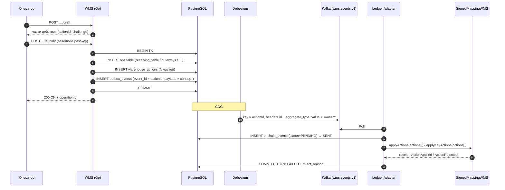

# Контракт данных: WMS ↔ Kafka ↔ Ledger Adapter ↔ Blockchain

**Версия:** 2.0
**Первоисточник:** [ADR-0001 «Подписанные складские действия»](../adr/0001-signed-actions.md) (§9 — конверт и outbox, §6 — исходы, §10 — размер)

---

## Обзор

Этот документ фиксирует формат данных на каждом этапе пайплайна:

```
WMS (Go) → outbox_events (PG) → Debezium → Kafka (wms.events.v1) → Ledger Adapter (Go) → onchain_events (PG) → SignedMappingWMS / ConsortiumRegistry
```

Единица записи — **подписанное действие**: одна строка outbox на одну часть операции (ADR-0001 §10), а не на товар. Ключевые действия (регистрация/отзыв ключа оператора) едут тем же конвертом.

---

## 1. outbox_events: строка подписанного действия

WMS пишет строку в **той же транзакции**, что и бизнес-операцию (`wms/internal/signedops/repository.go`, `WriteActions`; ключевые действия — `wms/internal/passkeys/actions_repository.go`, `SubmitKeyAction`):

```sql
INSERT INTO public.outbox_events (event_id, aggregate_id, aggregate_type, event_type, payload_hash, payload)
VALUES ($1, $1, 'signed_action', 'wms.action.v1', $2, $3::jsonb)
--      actionId  actionId                                hex(challenge)  конверт (§2)
```

| Колонка | Значение для действия |
|---|---|
| `event_id` | `actionId` (UUIDv7), он же ключ идемпотентности |
| `aggregate_id` | тот же `actionId` |
| `aggregate_type` | строго `signed_action` |
| `event_type` | `wms.action.v1` |
| `payload_hash` | challenge действия в hex (не sha256 от payload) |
| `payload` | конверт действия (§2) |

У ключевых действий строка та же: `action_id` из `key_actions` становится `event_id/aggregate_id`.

## 2. Конверт (payload)

Точное соответствие — `wms/internal/signedops/operation.go` (`envelopeDoc`) и `wms/internal/passkeys/envelope.go` (`keyActionEnvelopeDoc`); поля блока `webauthn` — `wms/internal/signedaction/envelope.go` (`EnvelopeWebAuthn`); парсер — `ledger-adapter/internal/consumer/message.go` (`parseSignedAction`).

```json
{
  "version": 1,
  "actionId": "01929c5e-6f00-7000-8000-000000001002",
  "actionType": 1,
  "itemIds": ["7c9e6679-7425-40de-944b-e07fc1f90ae7"],
  "detailsHash": "0x…",
  "keyId": "0x…",
  "webauthn": {
    "authenticatorData": "0x…",
    "clientDataJSON": "{\"type\":\"webauthn.get\",…}",
    "challengeIndex": 23,
    "typeIndex": 1,
    "r": "0x…",
    "s": "0x…"
  }
}
```

| Поле | Складское (1–4) | Ключевое (5–6) |
|---|---|---|
| `version` | `1` | `1` |
| `actionId` | UUID действия | UUID действия |
| `actionType` | 1–4 | 5–6 |
| `itemIds` | UUID товаров по возрастанию `itemId` | `[]` (пустой) |
| `detailsHash` | `0x` + 32 байта | **отсутствует** (контракт считает `keccak256(abi.encode(qx, qy))` сам) |
| `subjectKey` `{qx, qy}` | **отсутствует** | публичный ключ, который регистрируют/отзывают |
| `keyId` | ключ **подписанта** | ключ **админа-подписанта** |
| `webauthn` | assertion админ/оператора | assertion админа |

`keyId` во всех случаях — ключ подписанта; у ключевых действий он админ, а `subjectKey` — чей ключ регистрируется/отзывается.

## 3. Debezium EventRouter → Kafka

Конфигурация: `deploy/debezium/connectors/postgres-connector.json`.

```
Topic:   wms.events.v1                  (фиксирован, один для всех событий)
Key:     aggregate_id                   (actionId как строка UUID)
Value:   payload, сериализованный как JSON-строка
Headers:
  id:              event_id              (actionId как строка UUID)
  aggregate_type:  "signed_action"
```

- EventRouter берёт value из колонки `payload` (ADR-0001 §9). Value — JSON-строка, внутри которой конверт: парсер адаптера распаковывает её дважды (`json.Unmarshal` в `raw string`, затем в конверт; `message.go` `parseSignedAction`).
- Топик один, партиция одна (`deploy/kafka-init.sh`): порядок в цепи равен порядку коммитов в БД, на этом держится сериализация отзыва ключа (ADR-0001 §7).

## 4. Ledger Adapter: чтение и отправка

Код: `ledger-adapter/internal/consumer/` (`message.go`, `flusher_actions.go`).

Правила разбора (`Parse`):

1. `aggregate_type` обязателен и равен `signed_action` — всё прочее идёт в DLQ (старого пути на товар после #19 нет).
2. Header `id` — UUID `actionId`; Kafka key обязан совпадать с `id`.
3. `version` конверта — только 1; `actionId` внутри конверта обязан совпадать с header `id`.
4. `actionType` 1–4 → складское действие (`chain.WarehouseAction`), 5–6 → ключевое (`chain.KeyAction`, обязателен `subjectKey`).

Отправка:

- Окно сообщений режется на **подряд идущие сегменты одного вида**: складские действия → `SignedMappingWMS.applyActions(actions[])`, ключевые → `ConsortiumRegistry.applyKeyActions(actions[])`. Внутри сегмента порядок не меняется (отзыв ключа нельзя переставить раньше действий, которые были до него).
- Сегмент жадно пакуется в транзакции по **≤ 120 000 байт calldata** (`maxActionCalldata`); один signer, одна nonce-цепочка — порядок Kafka сохраняется.
- `itemId = uint256(keccak256(bytes(uuid)))` — порядок `itemIds` адаптер не меняет.

## 5. onchain_events (Ledger Adapter → PostgreSQL)

### Жизненный цикл записи

```
1. Сообщение получено            → INSERT (event_id, status=PENDING)
2. TX отправлена в блокчейн      → status=SENT, tx_hash
3. receipt: действие Applied     → status=COMMITTED
4. receipt: действие Rejected    → status=FAILED, reject_reason=<код ADR-0001 §6>
5. TX ревертнулась целиком       → status=FAILED, error_message
```

Схема: `wms/migrations/0001_init.up.sql` (`onchain_event_status = PENDING/SENT/COMMITTED/FAILED`), `reject_reason smallint` добавлен в `0015_key_actions.up.sql`.

### Что видит WMS

Статус действия WMS выводит из `onchain_events` (`wms/internal/signedaction/envelope.go`, `ConfirmationStateOf`): `NULL` → `SENT` (в outbox), `COMMITTED` → `APPLIED`, `FAILED` + причина → `REJECTED` с кодом, `FAILED` без причины → `FAILED`. Эндпоинт статуса операции — `GET /signed-actions/operations/{operationID}`.

Застрявшие `SENT` подтягивает reconcile-loop адаптера (`reconcile.go`).

## 6. warehouse_actions / key_actions: что читают гейты и аудит

`public.warehouse_actions` (миграция 0016) — по строке на часть операции:

| Колонка | Кем используется |
|---|---|
| `action_id` | join с `onchain_events.event_id` (гейты, статус операции, аудит) |
| `operation_id`, `part_index` | сборка операции, порядок частей |
| `action_type` (1–4) | выбор типа действия в гейтах |
| `item_ids uuid[]` | гейты: какие товары затронуло действие (`item_ids && …`, `item_ids @> …`) |
| `salt`, `details`, `details_hash` | аудит: пересчёт `detailsHash` из доменных таблиц |
| `challenge` | воспроизведение challenge сверки |
| `submitted_at` | черновик vs отправленное; гейты учитывают только отправленные |
| `signer_credential_id`, `created_by` | аудит: подписант и оператор |

`public.key_actions` (миграция 0015) — ключевые действия: `action_id`, `org_id`, `action_type` (5/6), `target_credential_id` (чей ключ), `signer_credential_id`, `challenge`, `submitted_at`. По ним WMS проверяет «нет ли действия в работе» и сериализует отзыв ключа со складскими действиями (`wms/internal/signedops/repository.go`, `LockSigner`).

### Гейты (`wms/internal/ledger/chain_status.go`)

- `CheckChainStatus(productIDs, aggregate)` — есть ли среди товаров `FAILED`-действие этого этапа → 409 `CHAIN_EVENT_REJECTED`.
- `UnconfirmedProducts(productIDs, aggregate)` — товары без `COMMITTED`-действия этапа (отгрузка требует подтверждённой сборки → 409 `PICKING_NOT_CONFIRMED`).

Оба читают `warehouse_actions ⋈ onchain_events`; статус `PENDING/SENT` гейт не блокирует.

## 7. Диаграмма полного пайплайна


